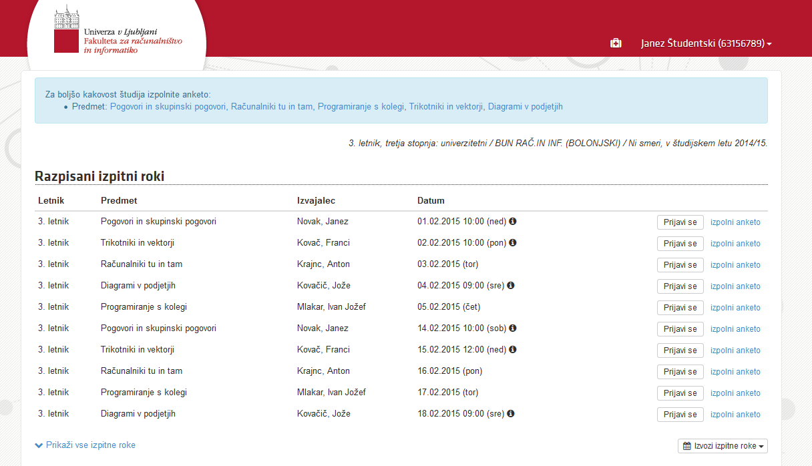

V sredo, 21. 1. 2015, smo imeli v avli fakultete dogodek za ozaveščanje o pomembnosti študentskih anket. Da ne bo nejasnosti, govorimo o anketah, ki so dostopne v sistemu STUDIS. Pred prijavo na izpit ali po opravljenem izpitu imate možnost izpolniti anketo o predmetu, ki ste ga obiskovali. Do ankete pridete s klikom na gumb ***izpolni anketo***, ki se nahaja poleg gumba ***Prijavi se***.

Zavedamo se, da imamo ljudje odpor do reševanja anket, ki so daljše od 30 sekund in od njih nimamo neposredne koristi. Vendar pa so uradne študentske ankete **zelo pomembne** za izboljšanje kakovosti študijskega procesa.

Pravzaprav so rezultati anket skoraj edina povratna informacija o izvedbi predmetov na naši fakulteti, zato imajo rezultati veliko moč nad spreminjanjem študijskega procesa. Vodstvo fakultete ukrepa pri težavah, **vendar le če jih zazna**. Za to pa je potreben velik odziv študentov, ker se le tako lahko dobi reprezentativne rezultate.

Vsaka izpolnjena anketa pripomore k boljši kvaliteti študija.
