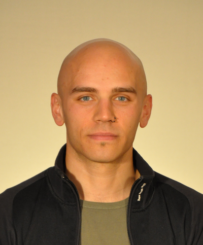

**1. Kaj ste želeli postati v otroštvu? Ste si takrat že predstavljali, da se boste ukvarjali z računalništvom oz. tehnologijo? Kaj vas je nazadnje motiviralo za smer računalništva?**

Študiral sem na Fakulteti za matematiko in fiziko. Pravzaprav nisem nikoli razmišljal o tem, kaj bi postal ali imel kakšne posebne želje. Svojo pripadnost matematiki (in računalništvu) lahko pripišem temu, da želim vsaki stvari priti do dna in jo rešiti.

**2. Vaši študentski dnevi so bili verjetno precej drugačni, kot so študentski dnevi današnjih študentov. Kako bi opisali to razliko?**

Bistveno razliko vidim v tem, da so današnji študenti precej bolj obremenjeni v smislu študijskih obveznosti. V mojih časih so bili predmeti celoletni, sprotnih obveznosti skoraj nismo imeli in smo si tako lažje organizirali in razporejali študijsko delo.

**3. Kakšni so bili vaši hobiji v času študija in ali ste katere od njih ohranili?**

Hobi, ki sem ga ohranil iz študijskih let, je elektronika (in programiranje mikrokrmilnikov). V času doktorskega študija sem se začel ukvarjati z vodenjem skupinskih vadb (Les Mills). Mogoče bi lahko tudi svojemu raziskovalnemu delu rekel hobi, saj se rad lotim vsakega novega vprašanja.

**4. Naslov vaše diplomske naloge, kdo je bil vaš mentor in zakaj ste izbrali ravno to temo?**

Diplomsko nalogo, katere naslov je bil Nov dokaz Bottove periodičnosti, sem opravljal pri Petru Pavešiću. Zanimata me namreč stabilna in nestabilna homotopska teorija, (širše) področje, ki je še vedno največji del mojega raziskovalnega dela.

**5. Kako vidite razvoj tehnologije v prihodnosti – kot problem ali prednost?**

Na vsak razvoj gledam kot na prednost, saj nam omogoči več vpogleda v to, kako stvari delujejo, več vpogleda v samo naravo stvari. Problem se pojavi pri posameznikih – končnih uporabnikih ‘proizvodov tega razvoja’, ki vse preveč pogosto ne razumejo (ali se ne zavedajo) pomena in delovanja naprav, ki jih uporabljajo.

**6. Najbolj zabavna stvar ki se vam je pripetila na vajah ali  predavanjih?**

Enkrat (na podiplomskem študiju) sem vstopil v predavalnico in po ca. 3 minutah poskusov reševanja prve naloge, saj to ni bilo izvedljivo zaradi glasnosti študentov, sem stopil do katedra, ga dvignil in pustil, da je padel z lastno težo na tla. Kateder je seveda preglasil (in utišal) študente. V naslednjih dveh urah pri teh vajah nisem več imel tovrstnih težav. (Lahko pa priznam, da se takrat nisem zabaval.)

**7. Kakšne so lastnosti dobrega profesorja? Kakšne so lastnosti dobrega asistenta?**

Na vprašanji bi odgovoril hkrati, saj sta tesno povezani. Profesorjeva naloga je predstaviti snov/teorijo na zanimiv način, asistentova naloga pa, da to snov razloži na skrbno izbranih primerih in tako pokaže/utemelji uporabnost teoretičnega ozadja. Tako oba (profesor in asistent) ohranjata visoko zanimanje študentov za snov. Skoraj nujno morata pri tem biti dostopna in odprta za vprašanja študentov.

**8. Na kratko podajte mnenje o bolonjskem študiju.**

Stvari, ki jih ne poznam natančno, nerad komentiram; in bolonjske deklaracije ne poznam natančno. Lahko pa komentiram izvajanje le-te v praksi. Veliko število sprotnih obveznosti v trenutni izvedbi bolonjskega študija na študente (in učitelje) ne deluje ravno motivacijsko. Bolje bi bilo, če bi študenti imeli možnost, da bi se lahko določeni stvari/snovi posvetili in si zanjo vzeli toliko časa, kolikor bi ga pač potrebovali. Imam občutek, da pri trenutnem načinu izvajanja študija to za večino ni mogoče.

**9. Vaša sanjska služba?**

Nikoli nisem ‘sanjal’ o posebni službi, sem pa v veliki meri zadovoljen s tem, kar počnem. Mogoče bi bilo dobro le, če bi imel več časa za raziskovalno delo.

**10. Vaš največji osebni dosežek?**

Na to ne gledam tako; menim, da je veliko stvari, ki prispevajo k celoti in zato ne morem izpostaviti le ene stvari.

**11. Kakšen bi bil vaš kratek nasvet za študente FRI?**

Nasvet za študente… Začnite razmišljati s svojo glavo, pri učenju ugotovite, zakaj je neka stvar taka, kot je, poskusite torej priti stvari do dna. Bodite vsaj malo kritični do svojega dela in kritično razmislite tudi o delu ostalih.

avtor: Vasilije Simeunović Djukić
