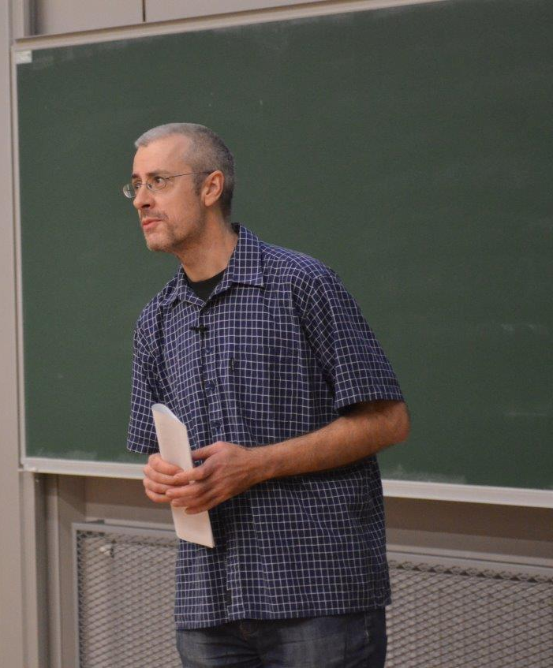

**1. Kaj ste želeli postati v otroštvu? Ste si takrat že predstavljali, da se boste ukvarjali z računalništvom oz. tehnologijo? Kaj vas je nazadnje motiviralo za smer računalništva?**

Odvisno od definicije otroštva. Prvi smrtnikom dostopni računalniki so se pojavili, ko sem bil v sedmem razredu in ko sem ga dobil, me je potegnilo v računalništvo, brez posebnega razmišljanja.\
Najprej sem sicer dve leti študiral fiziko, ki me je pritegnila zaradi dobrega srednješolskega učitelja, pa tudi na informativnem dnevu na FMF so nam povedali, da so najboljši programerji pravzaprav fiziki. Nekaj časa sem razmišljal tudi o študiju slovenščine.

**2. Vaši študentski dnevi so bili verjetno precej drugačni, kot so študentski dnevi današnjih študentov. Kako bi opisali to razliko?**

Razlika je predvsem v dostopnosti informacij. Študirali smo po učbenikih profesorjev in po zapiskih, ki smo jih skopirali od kolegic. Če si hotel izvedeti karkoli, o čemer niso predavali (in tega je bilo veliko, predavanja niso bila niti približno tako tehnična kot danes), pa si šel v Centralno tehniško knjižnico, v katalogu našel knjigo, ki te je zanimala, izpolnil listek, ki so ga poslali z dvigalom v skladišče, in čez pol ure si dobil odgovor, da je izposojena.\
Danes lahko karkoli najdete na internetu. Vključno s predavanji. To je novo tudi za učitelje, ki se moramo zavedati, da je na svetu veliko ljudi, ki predavajo boljše kot mi.  To nas postavi v novo vlogo: Miha Kos pravi, da »ne moremo biti učitelji, temveč navduševalci«. Pomočniki pri učenju.

**3. Kakšni so bili vaši hobiji v času študija in ali ste katere od njih ohranili?**

Veliko sem pel v različnih zborih. Tega skoraj ne počnem več. Sestavljal sem omare. Tudi za to ni več časa. Tudi bral sem, oboževal sem ruske klasike.  Za to sploh nimam več časa. Zadnja leta nimam več nobenega hobija, še za spanje nimam več dovolj časa.

**4. Naslov vaše diplomske naloge, kdo je bil vaš mentor in zakaj ste izbrali ravno to temo?**

Naslov je bil Dekompozicija realnih funkcij, mentor je bil prof. Bratko, somentor pa prof. Zupan. Pri njem zato, ker sva se že pred diplomo pogovarjala o moji zaposlitvi v laboratoriju.

**5. Kako vidite razvoj tehnologije v prihodnosti – kot problem ali prednost?**

Lojzeta Peterleta so vprašali, kakšno je njegovo mnenje o globalizaciji, in odgovoril je, da je to tako, kot da bi ga vprašali za mnenje o vremenu. Osebno mislim, da je dež koristen za polja, ni pa dobro, če ga je preveč, ker so potem rade poplave.

**6. Najbolj zabavna stvar, ki se vam je pripetila na vajah oz. predavanjih?**

Oh, večno vprašanje na katerega nikoli nimam odgovora. Najbolj smo se nasmejali, ko smo pri odkrivanju zakonitosti podatkov raziskovali podatke o srčnih boleznih in ugotovili, da imajo ženske neko prelomno obdobje nekje pri petdesetih. Študente sem vprašal, če se jim kaj sanja, kaj bi to bilo. Dobil sem odgovor, da takrat ženske pridejo v meta-fazo.

**7. Kakšne so lastnosti dobrega profesorja? Kakšne so lastnosti dobrega asistenta?**

Dostopnost. Znanje. Organiziranost. Nebluzaštvo.

**8. Na kratko podajte mnenje o bolonjskem študiju.**

Odgovor vam ne bo všeč, saj tudi meni ne bi bil, če bi bil študent. Obvezne tedenske domače naloge so super ideja. To vem, ker tudi sam redno delam tedenske tečaje (Coursera, TedX); vsi imajo redne tedenske domače naloge in od tečaja lahko kaj odneseš samo, če jih opravljaš.\
Edina bistvena razlika med starim in novim študijem (poleg tega, da je novi prekratek oziroma brez potrebe razsekan na dve stopnji) je poudarjenost sprotnega dela.

**9. Vaša sanjska služba?**

Je ni, ampak biti profesor je najbrž že kar blizu. Da bi bila res sanjska, pa bi na fakulteti veliko stvari spremenil. Zase pa pogrešam več časa, fleksibilnosti ter da bi lažje vsako leto počel kaj drugega.

**10. Vaš največji osebni dosežek?**

Naziv Naj profesor. To mi resnično veliko pomeni. Ne toliko nagrada kot taka; veliko mi pomeni, da je študentom moje delo z njimi všeč.

**11. Kakšen bi bil vaš kratek nasvet za študente FRI?**

Ne bodite leni. Ne crkljajte se. Dan ima 24 ur. Menda prodajajo skodelice z napisom »Tvoj dan ima toliko ur kot Beyoncin«.

avtor: Vasilije Simeunović Djukić
