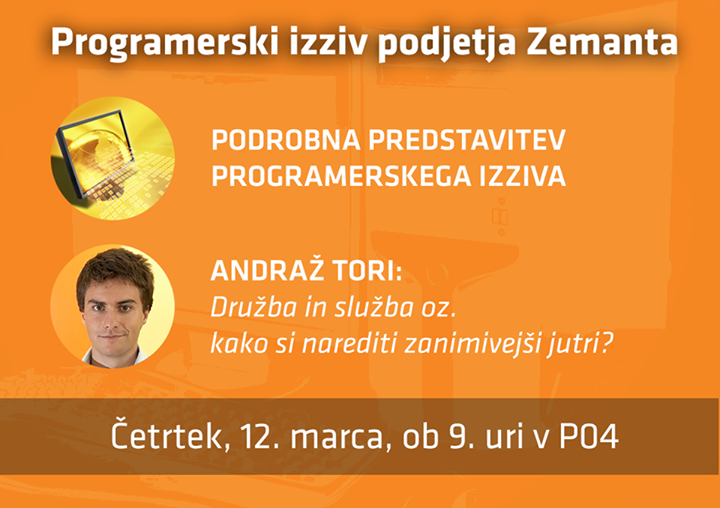

Svetovno znano podjetje Zemanta je v sodelovanju s FRI ponovno pripravilo tekmovanje za najboljšo programersko rešitev. Zmagovalci bodo v dar prejeli Raspberry Pi 2 in možnost opravljanja plačane poletne prakse v podjetju Zemanta.

Uvodno srečanje in predstavitvi izziva bo v četrtek, **12. marca ob 9. uri v P4**. Soustanovitelj podjetja Andraž Tori bo predstavil kako združevati službo in družbo in kako si narediti zanimivejši jutri. Povedal bo tudi, zakaj je za študente sodelovanje v izzivih pomembno že ob študiju.

