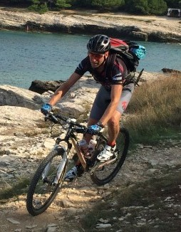

**1. Kaj ste želeli postati v otroštvu? Ste si takrat že predstavljali, da se boste ukvarjali z računalništvom oz. tehnologijo? Kaj vas je nazadnje motiviralo za smer računalništva?**

V sedmem razredu OŠ sem se udeležil tečaja programiranja v Basicu na računalniku Spectrum ZX, kasneje pa tudi tečaja elektronike pri Zvezi za tehnično kulturo. Po končani OŠ sem se želel vpisati na srednjo gradbeno šolo (zelo me je veselilo tehnično risanje), vendar so mi svetovali, naj se zaradi dobrih ocen vpišem drugam. Na koncu sem vseeno pristal na srednji gradbeni šoli.

**2. Vaši študentski dnevi so bili verjetno precej drugačni, kot so študentski dnevi današnjih študentov. Kako bi opisali to razliko?**

Ni bilo hitro dostopnih informacij, telefonov, mobitelov. Bile so oglasne deske, ni bilo bonov, v Rožni dolini, kjer sem v študijskih letih prebival, je bil samo en avtomobil. Študentskega življenja se spominjam kot zelo žurerskega, predvsem v prvih dveh letih. Na Gerbičevi, v t.i. Klubu, smo lahko dobili poceni bambus.\
Štipendij ni bilo oz. vsaj niso bile tako urejene kot danes. Ko sem začel študirati, je oče ostal brez službe, zato sem bil primoran ob petih zjutraj prodajati Salomonov oglasnik na križiščih, ponoči pa dežurati v študentskih domovih. Šele v 3. letniku sem dobil prvo službo v elektro podjetju, kjer smo razvijali elektroniko za tiste rumene stebričke za Klic v sili na avtocesti (SOS).\
So pa to bili najlepši dnevi mojega življenja.

**3. Kakšni so bili vaši hobiji v času študija in ali ste katere od njih ohranili?**

Za hobije sem imel takrat premalo časa in denarja. Rad kolesarim, vendar sem si prvo pravo kolo lahko privoščil šele v 4. letniku fakultete. Rad sem doma z družino.

**4. Naslov vaše diplomske naloge, kdo je bil vaš mentor in zakaj ste izbrali ravno to temo?**

Naslov je bil Metode mehkega klasifikatorja za prepoznavanje binarnih slik, mentor pa Veselko Guštin. Vse se je začelo, ko je na vajah v 4. letniku asistent, kasneje tudi moj mentor Veselko, povedal za izziv, da bi nekdo razvil aplikacijo za merjenje dolžine smučarskih skokov. Ta izziv je pozneje podprla tudi organizacija FIS (International Ski Federation). Iz tega je izhajala moja diplomska naloga, v kateri sem se ukvarjal z optičnim prepoznavanjem pisave.

**5. Kako vidite razvoj tehnologije v prihodnosti, kot problem ali prednost in zakaj?**

To je zelo nehvaležno napovedovati. Kdorkoli se je lotil česa takšnega, se je osmešil. Vsekakor ima napredek svoje pluse in minuse.\
Bill Gates, npr., se je osmešil, ko je napovedal, da ne bo nihče nikoli potreboval več kot je 640K pomnilnika na računalniku. Ali Steve Ballmer (Microsoft CEO), čigar komentar ob izdaji iPhona je bil, da te naprave nihče ne bo kupil ali potreboval ipd.

**6. Najbolj zabavna stvar ki se vam je pripetila na vajah oz. predavanjih?**

Zgodba izhaja iz mojih začetnih let poučevanja. Gostoval sem na faksu, se pripravil na uro in za odprtimi vrati sedel in čakal. Mimo učilnice  se sprehodi starejša profesorica, ki začne name vpiti, češ, kaj počnem tukaj in od kje mi ključi (v računalniške učilnice namreč ni smel nihče razen profesorjev). Kaj hitro je dojela, da je zgrešila in mi povedala, da moram to vzeti kot kompliment, ker izgledam tako mlad.

**7. Kakšne so lastnosti dobrega profesorja?**

Rad mora predavati, enostavno mora imeti rad to kar počne; meni samemu se predavanja zdijo kot umik od drugih obveznosti, uživanje. Poleg tega mora imeti pozitivno tremo in seveda dovolj izkušenj.

**8. Na kratko podajte mnenje o bolonjskem študiju.**

Prednost je npr. redno učenje, kar sem pogrešal pri svojem študiju. Po drugi strani pa vse poteka prehitro, odvzeta so temeljna znanja in s tem širina. Pomanjkljivost je tudi preobremenjenost.

**9. Vaša sanjska služba…?**

Mizar, sadjar, serviser koles (to bom počel, ko bom v pokoju). Je pa tudi služba, ki jo opravljam sedaj, super.

**10. Vaš največji osebni dosežek.**

O tem ne bi rad govoril, saj sem še mlad in bodo največji dosežki še prišli.

**11. Kratek nasvet za študente FRI**

Bodite tako kul, kot ste!

avtor: Vasilije Simeunović Djukić
