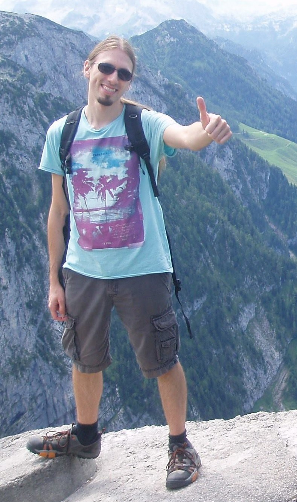

**1. Kaj ste želeli postati v otroštvu? Ste si takrat že predstavljali, da se boste ukvarjali z** **računalništvom oz. tehnologijo? Kaj vas je nazadnje motiviralo za smer računalništva?**

Z računalništvom sem se prvič srečal pri šestih letih in od takrat naprej me v to vedno bolj vleče. Moj oče je inženir elektrotehnike in je bil eden izmed prvih, ki so v Sloveniji sestavljali ter popravljali prve PC-je. Navdušen sem bil tudi nad fiziko, vendar sem svoje šolanje posvetil predvsem računalništvu.

**2. Vaši študentski dnevi so bili verjetno precej drugačni, kot so študentski dnevi današnjih** **študentov. Kako bi opisali to razliko?**

Starejši profesorji na faksu so dajali vtis nedostopnosti in tudi asistenti so bili v mojih časih nekoliko starejši in tako je bilo v povprečju z njimi težje vzpostaviti stik. Danes se pozna prenovitev kadrov v mlajše asistente. Vse se je moderniziralo: uporaba učilnice, internet, starejši sošolci pomagajo mlajšim.

**3. Kakšni so bili vaši hobiji v času študija in ali ste katere od njih ohranili?**

Ohranil sem večino hobijev. Zelo rad se družim s prijatelji. Rad tečem, snowboardam, všeč mi je paintball… Moja dolgoletna želja je, da bi se, če bi mi čas to dopuščal, naučil igrati kitaro. Rad poslušam in se ukvarjam z glasbo. Za vse te aktivnosti pa mi enostavno zmanjkuje časa, saj se ukvarjam z raziskovanjem za doktorat.

**4. Naslov vaše diplomske naloge, kdo je bil vaš mentor in zakaj ste izbrali ravno to temo?**

Naslov je bil Spodbujevalno učenje, mentor pa Branko Šter. Za to temo me je navdihnil omenjeni profesor, ko sem kot študent delal v njegovem laboratoriju.

**5. Kako vidite razvoj tehnologije v prihodnosti – kot problem ali prednost?**

Tehnologija v zadnjem desetletju raste eksponentno. Zelo hitro je tudi njeno prodiranje v  družbo, vendar ima vsak tak »bum« svoje pluse in minuse. Že od industrijske revolucije naprej smo priča veliko zlorabam novih tehnologij. Danes, na primer,  je aktualnih več primerov, a naj navedem enega izmed teh: socialna omrežja. Le-ta so nastala preko noči in šele sedaj se soočamo s težavami, kot so vprašanje zasebnosti itd.\
Pravijo, da so revolucionarji tisti znanstveniki v ozadju, ki precej hitro napredujejo in prehitevajo družbo, ki jim je zmožna začeti slediti šele pozneje. In prav je tako.

**6. Najbolj zabavna stvar, ki se vam je pripetila na vajah oz. predavanjih?**

Na Škisovi tržnici sem srečal svoje študente, z njimi poklepetal in skupaj smo tudi malo nazdravili. Naslednji dan sem imel zgodaj zjutraj te iste študente na vajah, seveda pa jih je več kot polovica manjkala. Na začetku ure mi eden izmed študentov reče: »Jaz sem bil prepričan, da bodo vaje odpadle.« (smeh)

**7. Kakšne so lastnosti dobrega profesorja? Kakšne so lastnosti dobrega asistenta?**

Zelo pomemben je občutek za ljudi oz. empatičnost, sposobnost, da se pogovarjaš z ljudmi in hkrati spremljaš njihove odzive in glede na to usmerjaš pogovor. Dober predavatelj mora znati podati snov na strukturiran način, snov mora razčleniti in imeti splošen pregled predmeta. Imeti mora odprt in pravičen odnos do vseh. Če česa ne ve, tega ne sme prikrivati, temveč priznati; če stori kaj narobe, se mora opravičiti. Pravičen mora biti do tistih študentov, ki pokažejo svoj trud.

**8. Na kratko podajte mnenje o bolonjskem študiju.**

Če najprej naštejem nekaj prednosti: programi so bili predhodno precej zastareli, z reformo pa so se obnovili in same vsebine, predvsem na VSŠ, so se izboljšale. Programi so se poenotili z evropskimi državami, tako da idejni koncept ni zgrešen. Nekaj drugega pa je, kako se to izvaja v praksi. Med samo menjavo programov je bilo narejene veliko kolateralne škode, saj so študenti med samim procesom obstali v zraku brez navodil. Sam študij glede na povečano intenzivnost ni pridobil veliko, samo bolj je obremenil tako pedagoške delavce kot tudi študente. Študenti FRI-ja niso sedaj nič bolj usposobljeni za industrijo, kot so bili prej; po pogovorih s kolegi ugotavljamo, da se dogaja ravno obratno. Poleg tega je obremenjenost že tako visoka in stresna, da je dejansko nezdrava. Posameznik mora imeti prosti čas za lastne hobije in projekte, saj iz študentov nima smisla delati robotov ali »napiflanih« strokovnjakov, ki bi bili brez življenjskih izkušenj. Fakulteta in uradni pedagoški proces ne smeta in niti ne moreta biti edini vir strokovnega in osebnostnega razvoja mladih generacij, zato jim morata pustiti več prostega časa.

**9. Vaša sanjska služba?**

Zaenkrat še ne sanjam o ničemer posebnem. Vidim, da se dobro znajdem na vodstvenih položajih, vodenju skupinskega dela ali projektov. Zanimivo bi mi bilo delati v raziskovalnem oddelku v industriji, biti profesor na fakulteti ali pa biti udeležen v start-up podjetju.

**10. Vaš največji osebni dosežek?**

Ga še čakam. Veliko je bilo individualnih dosežkov, ki jih ne bi izpostavljal, sicer pa tudi veliko malih, ki jih dejansko ne opaziš. Ko opravim doktorat, na primer, bo to zame velik dosežek.

**11. Kakšen bi bil vaš kratek nasvet za študente FRI?**

Vplivajte na pedagoški proces, dajajte feedback, odzivajte se na pozive ŠS-ja. Če boste sedaj uspeli kaj spremeniti v dobro študentov, to ne bo vplivalo samo na vas, temveč tudi na vse prihodnje študente.  Le tako bomo lahko imeli kvalitetno ustanovo s kvalitetnimi ljudmi ter posledično tudi kvalitetno stroko in družbo.

avtor: Vasilije Simeunović Djukić
