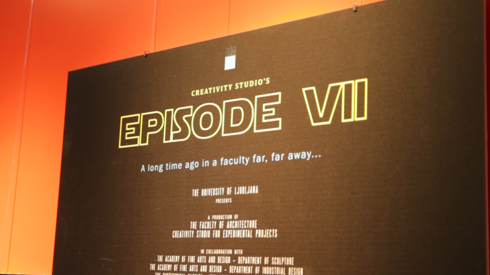
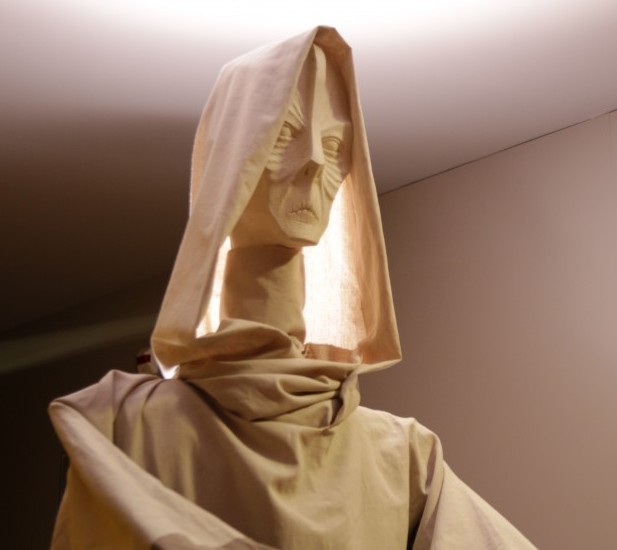
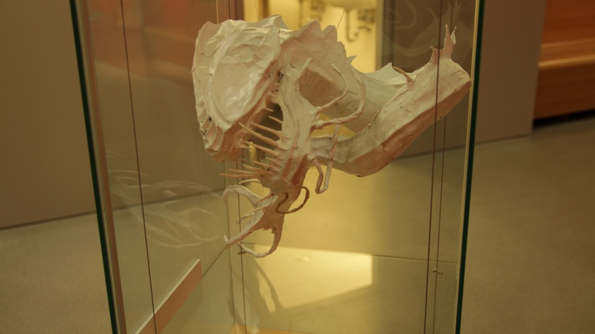
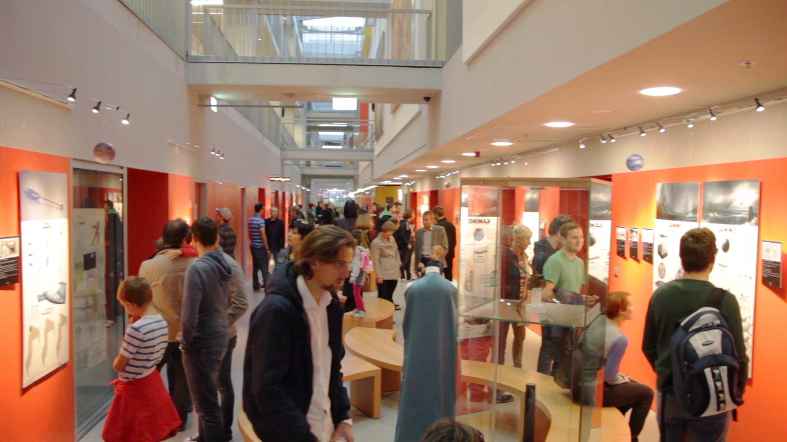

Le kdo še ni slišal za legendarno sago Vojne zvezd oziroma Star Wars in za Darth Vaderja, viteza teme, ali pa za poslednjega Jedi viteza, Luka Skywalkerja. Z Epizodo VII se po nekajletnem premoru in Disneyevim prevzemom saga znova vrača v kinodvorane, a še prej vas čaka nekaj drugega … Kaj če vam povem, da imamo v Sloveniji svojo verzijo Epizode VII?

Da, prav ste prebrali. Študenti in študentke različnih fakultet Univerze v Ljubljani smo ustvarili svojo epizodo Vojne zvezd. Oktobra 2013 ste lahko v novicah na spletni strani Fakultete za računalništvo in informatiko zasledili povabilo za sodelovanje pri projektu »Star Wars Episode VII: Designed by you«, ki je nastala pod okriljem doc. dr. Ora Ettlingerja v sklopu Studia za ustvarjalnost in eksperimentiranje na Fakulteti za arhitekturo. Tekom njegovega seminarja je v šolskem letu 2012/13 potekal razvoj arhitekturnih računalniških iger, v letu 2013/14 pa je prišel na vrsto filmski projekt. Naj poudarim, da nismo ustvarili celovečernega filma (čeprav bi si to želeli), nastala pa je razstava s celotno zgodbo in slikovnimi reprezentacijami scen, kot tudi plakati s podrobnimi dizajni, s pomočjo katerih bi lahko hollywoodska produkcija ustvarila pravi film. Ti so bili do decembra razstavljeni v prostorih naše fakultete, svečana otvoritev pa je potekala 26. septembra v okviru dogodka Noč raziskovalcev. Pri projektu so nastale tudi tri lutke s kostumi v realni velikosti, modeli oz. makete elementov iz filma, vse skupaj pa smo zaključili s knjigo, ki pa zaradi omejitev avtorskih pravic vsebuje le dizajne.

**Kako se je začelo**

Osebno sem bil v začetku glede projekta zaradi vseh fakultetnih obveznosti nekoliko skeptičen, pa vendar me je misel na sodelovanje pri nečem tako zanimivem prepričala, da sem se udeležil razgovora. Tam smo pred profesorji večih fakultet, med katerimi je bil tudi doc. dr. Iztok Lebar Bajc iz Fakultete za računalništvo in informatiko, najprej predstavili svoje izdelke in na kratko opisali, kje se vidimo znotraj tega projekta ter zakaj si želimo sodelovati. Zaradi številčnosti kandidatov pa so se odločili, da na razgovor vstopamo kar po trije skupaj. Tako smo se nekateri študentje med seboj spoznali že ob čakanju na razgovor, na samem razgovoru pa smo lahko videli zelo zanimive stvaritve drug drugega. Glede na videno in slišano se je profesor skupaj s svojimi tremi asistenti odločil za okvirno ekipo, ki bi jo tekom zimskega semestra pripravil na ustvarjanje končnega izdelka, v poletnem pa bi se ustvarjanje dejansko začelo.

Po kakšnem tednu sem bil obveščen, da sem bil na projekt sprejet, in tako smo se na ponedeljek prvič srečali vsi srečni izbranci in se s kratko predstavitvijo svojega dela še enkrat predstavili. Brez dvoma se je zbrala precej raznolika, aktivna in nasploh zanimiva skupina študentov z raznih področij, a kot edini, ki se z risanjem predhodno nisem kaj dosti ukvarjal, sem verjetno še najbolj izstopal.

**Priprave na ustvarjalni proces**

Tako smo v prvi polovici šolskega leta v skupinah analizirali vsa zgodovinska obdobja, zgodovinski razvoj filma z znanstveno fantastiko, analizirali vse Star wars filme, svetove in glavne junake v njih, vse skupaj pa smo začinili še s precejšnjo mero sladkarij, ki smo jih prinesli na sestanke. Poleg stalnega dela, raziskovanja gradiv, pisanja »rulebook-ov« in gledanja filmov, pa sem se naučil še druge stvari, ki se jih lahko naučiš le pri delu na takšnih projektih. Na prvem mestu je predvsem način pristopa do projektov, ki se začne z analizo materiala, s katerim si ustvariš neko referenčno bazo znanja o tem področju, opazovanje stvari iz različnih zornih kotov in kar je še najbolj pomembno, zavedanje dejstva, da vsi izhajamo iz nekega svojega ozadja, iz katerega črpamo ideje. S tem se lažje rešimo omejitve trenutne miselnosti, ki nas obkroža, in si sami postavimo pogoje, v katerih deluje naša domišljija. Hkrati sem se naučil tudi mnogo o sodelovanju, vodenju in samem ustvarjanju delujoče in zanesljive skupine, saj je bil namen prvega semestra poleg same priprave na dizajniranje tudi ustvarjanje zanesljive ekipe študentov in medsebojno spoznavanje preko skupinskega dela. Zaradi tega smo lahko v drugem semestru dobro ocenili, kdo so tisti posamezniki, s  katerimi smo zelo produktivni in kdo tisti, s katerimi delamo nekoliko težje. Tako smo lahko sestavili optimalne dizajnerske skupine.

**Dizajniranje naše Vojne zvezd**

Lahko bi rekli, da se je ustvarjanje začelo že konec zimskega semestra, ko sta prišli na vrsto analiza in ustvarjanje naše zgodbe, iz katere smo potem lahko razbrali na katerih planetih oz. delih galaksije se naš film dogaja. Vsako skupino smo zadolžili za ustvarjanje enega od planetov z vsem, kar pride zraven. Tako smo lahko pričeli s fazo dizajniranja naših svetov, njihovih prebivalcev, arhitekture in tehnologije. To je bila precej svobodna faza poskusov in variacij dizajnov, preko katerih smo poskušali najti tisto nekaj, kar bi najbolje izražalo miselnost in strukturo družbe, ki smo jo ustvarjali.

Sredi aprila smo pričeli s fazo produkcije, v okviru katere so nastale končne skice in tridimenzionalni modeli, vzporedno pa je potekala priprava kadriranja scen iz zgodbe za pretvorbo v stripovsko obliko. Maj je bil rezerviran za pripravo razstave, a kot vedno stvari niso šle po načrtih. Tako smo teden pred prvo razstavo praktično bivali na Fakulteti za arhitekturo, na dan D pa vse skupaj postavili in razstavo odprli z dvournim zamikom. Kljub temu je bila prva razstava zaznamovana z neverjetno udeležbo; ljudje so se kljub zamudi vrnili in se udeležili otvoritve. Tekom poletja smo plakate še nekoliko izboljšali, končali pa smo tudi z ustvarjanjem dokumentarnega filma, ki prikazuje zakulisje ustvarjanja razstave. Ogledate si ga lahko na spletnem portalu Youtube, in sicer na sledeči povezavi: [https://youtu.be/CHNKwDbFW8U](https://youtu.be/CHNKwDbFW8U) . Če bi o projektu radi izvedeli še kaj več, nas lahko spremljate na temu posvečeni  facebook stani ([www.facebook.com/theStarWarsProject](http://www.facebook.com/theStarWarsProject) ).

Za konec naj omenim, da je bila to zame ena od najbolj poučnih in ustvarjalnih izkušenj, ob kateri sem izkusil veliko dobrih strani dela v skupini in kako se spopasti s tistimi slabimi. Zaradi projekta sem dobil več zaupanja v svoje sposobnosti  in si pridobil nova znanja, ki jih sicer zagotovo ne bi. Tudi vam, dragi bralci, priporočam, da, v kolikor boste imeli takšno možnost, zagrabite za takšno delovno izkušnjo, kjerkoli že bo, saj se boste ogromno naučili in osebnostno zrasli.

avtor: Sašo Jakljevič
