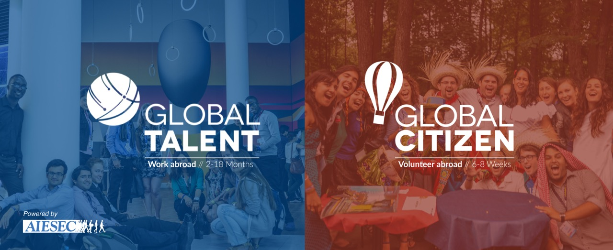

Študij je pomemben, vendar obstajajo stvari, ki jih od listanja po učbenikih in dolgih ur preživetih v knjižnici preprosto ne moreš pridobiti. Poskrbi, da boš po izpitnem obdobju svoj čas preživel/a se najbolj koristno. Privošči si izkušnjo, ki te spremenila za vedno!\
AIESEC je največja študentska organizacija na svetu, ki študentom in nedavnim diplomantom ponuja priložnosti za pripravništvo, delo in pozitiven vpliv na skupnost!

Programi, ki jih ponujamo, so prostovoljske prakse – »Global Citizen« in plačane prakse – »Global Talent«. Pred kratkim se je programu »Global Talent« pridružil še program »Global Entrepreneur«, preko katerega lahko najdeš prakse v mlajših podjetjih.

Več informacij lahko preberete v naši zloženki: [AIESEC prakse](NL_12.pdf)
