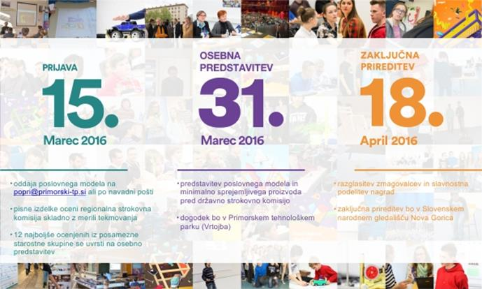

Vabimo vse, ki med mladimi vzpodbujate podjetnost in izvajate podjetne vsebine v okviru formalnega ali neformalnega izobraževanja, da se vključite v projekt ustvarjanja prihodnosti mladih. V Primorskem tehnološkem parku že enajsto leto zapored organiziramo\
vseslovensko podjetniško tekmovanje POPRI.\
Kdo lahko sodeluje?

\*         Osnovnošolci (7., 8., in 9. razred)\
\*         Srednješolci\
\*         Študenti in drugi posamezniki ali skupine do 29 let, ki še nimajo lastnega podjetja.

Kaj pridobijo tekmovalci?

\*         Atraktivne nagrade in priznanja\
\*         Promocijo v javnosti\
\*         Svetovanje pri oblikovanju podjetniške ideje in poslovnega modela\
\*         Povratno informacijo o podjetniški ideji skozi oceno strokovne komisije\
\*         Izkušnjo javnega nastopanja\
\*         Nova poznanstva in nepozabno izkušnjo\
\
**Zakaj na tekmovanje?**

Tekmovanje za najboljšo podjetniško idejo oziroma najboljše razdelan poslovni model je odlična priložnost, da mladi predstavijo svoje delo, ki ste ga skupaj z njimi ustvarili tekom izobraževanj, se pomerijo z vrstniki iz cele Slovenije in preverijo ali je njihova ideja dobra skozi oči strokovne komisije, sestavljene iz podjetnikov in pedagoških delavcev.

Cilj tekmovanja POPRI je spodbuditi mlade, da svoje ideje na podjeten način razvijejo v nove izdelke in storitve ter zanje izdelajo učinkovite podjetniške zgodbe.

**Prijava je še enostavnejša**

Izpolnjevanje poslovnega modela je enostavno, saj je na [www.popri.si/#prijava](http://www.popri.si/#prijava) na voljo predloga, ki uporabnike s priročnimi \>plonk\< nasveti vodi skozi reševanje.

Od letos naprej lahko bodoči tekmovalci uporabljajo tudi spletno platformo Mikrobiz, ki na enem mestu omogoča izpolnjevanje in urejanje poslovnega modela, več osebam hkrati.\
Uporaba spletne platforme je brezplačna, potrebna je le registracija. Oglejte si portal na: [http://www.mikrobiz.net/](http://www.mikrobiz.net/)

Pridružite se!

Ali se želite udeležiti tekmovanja POPRI? Stopite v stik z nami in nas vprašajte vse, kar vas zanima.

V fazi pred rokom za oddajo poslovnih modelov, je za priključitev izobraževalne institucije k tekmovanju dovolj to, da nam v elektronskem sporočilu napišete, da boste mlade informirali o možnosti sodelovanja na tekmovanju.\
Po pošti vam bomo posredovali plakat in promocijske zloženke, ki so na voljo tudi v PDF obliki. V zameno bomo vključili ime in povezavo do vaše institucije na spletno stran POPRI.

Z veseljem vas tudi obiščemo in pripravimo kratko predstavitev tekmovanja na vaši šoli!

Če še vedno premišljujete o prijavi, vas vabimo, da si ogledate utrinke iz tekmovanja lani: [https://www.youtube.com/watch?v=XDrz_hXVIro](https://www.youtube.com/watch?v=XDrz_hXVIro)
