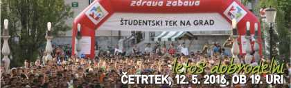
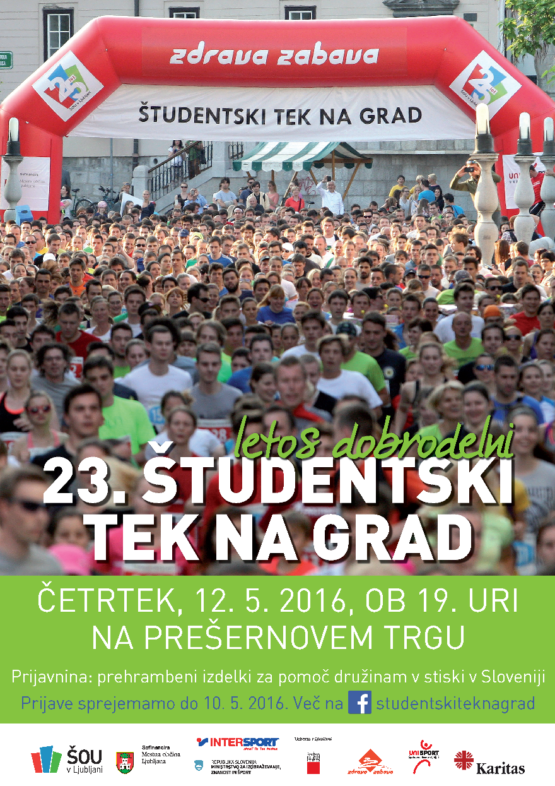

**Vabilo na 23. Študentski tek na grad**

V četrtek, 12. maja vas vabimo na tradicionalni študentski tek po ljubljanskih ulicah od Prešernovega trga do Ljubljanskega gradu. Traso dolgo 2,5 km je v 22-ih tekaških izvedbah preteklo že več kot 20.000 tekačic in tekačev. Prvih 1.800 udeležencev **prejme spominsko majico** 23. Študentskega teka na grad. Letos bo Študentski tek na grad tudi dobrodelen. Pod geslom „**Sem študent in pomagam**” bomo zbirali prehrambene izdelke za slovenske družine v stiski. Pridruži se nam tudi ti. Za več klikni [tukaj](https://sites.google.com/a/student.uni-lj.si/sportna-zveza/programi-zveze/programi-sportne-zveze-univerze-v-ljubljani-2015-16/studentski-tek-na-grad-2016).

