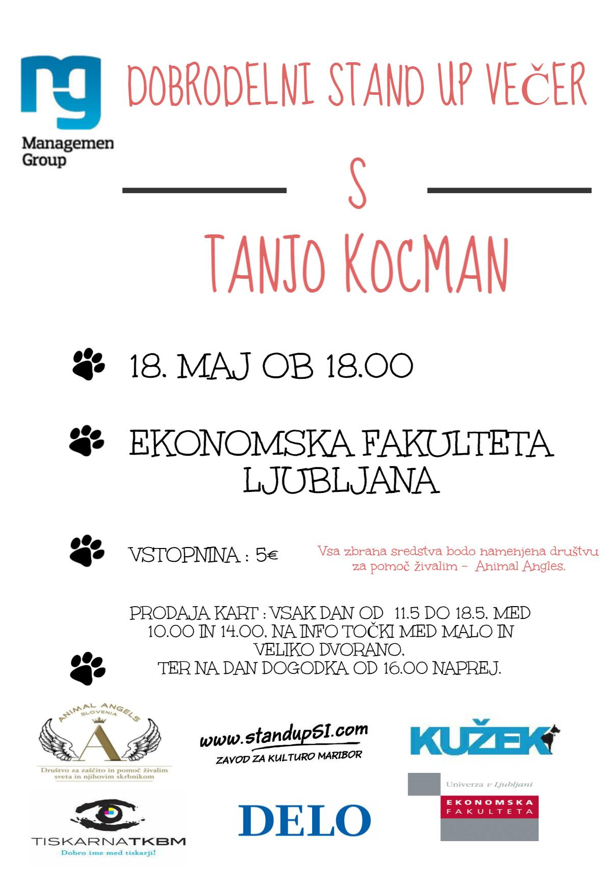

Neprofitno neodvisna in neprofitna študentska organizacija Management Group, ki deluje na Ekonomski fakulteti v Ljubljani, organizira Dobrodelni stand up večer s Tanjo Kocman. Dogodek je organiziran v sodelovanju z Zavodom za kulturo Maribor – http://www.standupsi.com/, revijo Kužek in društvom za zaščito in pomoč živalim Animal Angels. Ves izkupiček od prodanih vstopnic, bo namenjen društvu Animal Angels.

KDAJ : 18.5.2016 OB 18.00 uri

KJE : Na Ekonomska fakulteta Ljubljana

CENA VSTOPNICE : 5€

Karte je možno kupiti vsak dan od **11.5 do 18.5** (razen čez vikend) na** Info točki Ekonomske fakultete** **(med malo in veliko dvorano)** **med 10.00 in 14.00 uro**.

**Na dan dogodka** tudi pred samim dogodkom,** od 16.00 ure naprej**. Karte se lahko kupijo tudi **neposredno preko nakazila na TRR Animal Angles in potem prevzamejo na dan dogodka. **

Podatki za nakazilo:

Naročite lahko na: [**Group.animalangels@gmail.com**](mailto:Group.animalangels@gmail.com)

**Cena: 5 eur**\
Nakažete na:\
ANIMAL ANGELS\
Levstikova 26\
8210 Trebnje\
TRR: SI56 0201 4025 9397 558

** **

**Tanja Kocman, stand up komičarka**

Neuradna miss domače Ješence in ljubiteljica špohtlov je rojena za humor.

Poleg rednega negovanja stand up kulture (tudi v oddaji Brez dlake na jeziku) kot koscenaristka in sovoditeljica sodeluje v satirični oddaji Bizarno Aktualno in igra v komediji XXL Bejbe.

Tanja Kocman je sicer od življenja šolana ženska, a tudi od fakultete 😉 . Je univerzitetno diplomirana medijska komunikologinja (kar pomeni, da lahko zelo izobraženo čisti kable;). Vsako jutro jo lahko v vlogi voditeljice slišite na HitRadiu Center. Tako, govori že od 5h zjutraj (in se večinoma ne ustavi do večera).

Ker pa ima ogromno za povedat, jo lahko v vsej njeni sproščeni gloriji uzrete tudi na kavču v oddaji Bog ne daj, da bi crknu televizor. Velikokrat bo rekla, kar si mislite, a ne upate povedati na glas.

Če vas zanima njen pogled na odnose (ki jih občasno celo ima) pa preberite njeno kolumno na Siolu.

V svojih stand up nastopih pogosto razkriva skrite paradokse in nasmeji s pronicljivim humorjem. Na odru je izjemno odzivna, iznajdljiva in z občutkom za občinstvo, zato ga vselej navduši.

Dovršene domislice in humorne analogije kot jih še niste slišali vas bodo dodobra nasmejale tudi tokrat, ostro uho pa bo uživalo tudi družbeno-kritični noti njenega humorja.

(Vir: <http://www.standupsi.com/index.php/komiki/ekskluzivno/tanja-kocman>)

