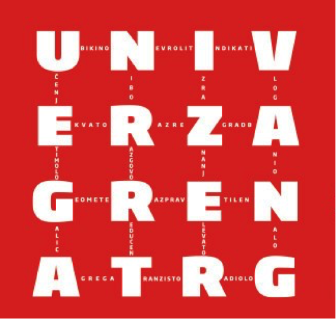

**ELEVATOR PITCH FESTIVAL: UNIVERZA GRE NA TRG 2016!**

25. **maja 2016, od 16.00 dalje, na Kongresnem trgu, pred rektoratom Univerze v Ljubljani**

**VSI, KI VESTE, ZAKAJ JE PRAVI ČAS ZA GRADITEV KARIERE ČAS ŠTUDIJA, BOSTE Z NAMI IN DELODAJALCI TAM!**

**in se boste:**

**MREŽILI, POVEZOVALI, SODELOVALI, SPOZNAVALI, INFORMIRALI, ZABAVALI**

Letos KC UL že četrtič organiziramo največji dogodek povezovanja študentk in študentov z delodajalci, strokovnjaki, kadroviki, iskalci novih talentov, direktorji, sodelavci … t.i. **Elevator pitch festival: Univerza gre na trg!** Tudi letos, tako kot že lani, se boste v domačnosti avtobusov Ljubljanskega potniškega prometa – **vašega prevoznika na poteh v prihodnost –** lahko srečali in povezali z več kot 60-timi predstavniki različnih subjektov na trgu dela. Sodelovanje z nami so do sedaj potrdila podjetja, ki jih najdete [TUKAJ](https://kc.uni-lj.si/novice/-/asset_publisher/Qrg9jsDUX1Lb/content/elevator-pitch-festival-univerza-gre-na-trg-2016?redirect=https%3A%2F%2Fkc.uni-lj.si%2Fnovice%3Fp_p_id%3D101_INSTANCE_Qrg9jsDUX1Lb%26p_p_lifecycle%3D0%26p_p_state%3Dnormal%26p_p_mode%3Dview%26p_p_col_id%3Dcolumn-2%26p_p_col_count%3D2%26_101_INSTANCE_Qrg9jsDUX1Lb_currentURL%3D%252Fnovice%26_101_INSTANCE_Qrg9jsDUX1Lb_portletAjaxable%3D1) in pričakujemo jih še nekaj!

**Prijave** za študentke in študente UL so odprte od **5. 5. 2016** na neposredni [povezavi](https://prijava.uni-lj.si/kc/_layouts/listform.aspx?PageType=8&ListId=%7bEA25F739-222F-441D-883E-34E1049A34CC%7d&RootFolder=) in jih bomo sprejemali do zapolnitve mest oz. najdlje do 15. 5. 2016. Število mest je omejeno – največ 200 – zato bo veljalo načelo: **kdor se prej prijavi – se prej in udobneje pelje!**

**Za več informacij se lahko obrnete tudi na** [**sabina.znidarsic-zagar@uni-lj.si**](mailto:sabina.znidarsic-zagar@uni-lj.si)**, 030- 640 641.**
