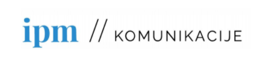

Ekipo podjetja IPM Komunikacije d. o. o. sestavljajo mladi, a izkušeni posamezniki, ki jih poleg pestrega nabora znanj z različnih področij komunikacijskega menedžmenta druži želja po razvoju, napredku in rasti. Pri svojem delu se osredotočamo na oblikovanje celovitih, strateško oblikovanih rešitev na področju komuniciranja. Naša strast so zgodbe mikro, majhnih in srednje velikih podjetij. Zgodbe ljudi. Takih, ki verjamejo v svoje delo prav toliko kot mi.

Ekipa IPM Komunikacije zaradi povečanega obsega dela išče novega, nadobudnega in kompetentnega člana ali članico, ki bi opravljal(-a) delo razvijalca(-ke) spletnih strani.

Zahtevano znanje za delo razvijalca(-ke) spletnih strani:

- izkušnje z izdelovanjem spletnih strani/trgovin na wordpressu,
- Znanje PHP/JS/CSS,
- uporabe kakšnega template engina (npr. Laravel Blade) in procesa programiranja (GIT; kanban flow),
- pripadnost ekipi, spoštovanje navodil nadrejenih ter vestno izpolnjevanje delovnih obveznosti.

Nudimo vam prijetno delovno okolje, ki temelji na dobrih odnosih in profesionalni rasti posameznikov ter možnost redne zaposlitve v primeru uspešnega poskusnega sodelovanja.

Z izbranimi kandidati bomo opravili osebni intervju, ki bo predvidoma potekal na daljavo. Podrobnosti o poteku dela, delovniku in plačilu se bomo dogovorili med intervjujem. Motivacijsko pismo in vaš CV nam pošljite na naslov info@ipm-komunikacije.si.
