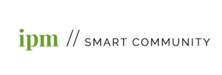

Podjetje IPM Smart Community d. o. o. z vizijo ustvarjanja samozadostnih in varnih mest s tehnološko podprto, učinkovito in transparentno javno upravo ter infrastrukturo predstavlja most med javnim in zasebnim sektorjem. Pametno interakcijo ter posledično povrnitev medsebojnega zaupanja med državljani in javnimi institucijami vidimo kot ključ za zdravo delovanje demokratične družbe.

Mlada ekipa IPM Smart Community zaradi povečanega obsega dela išče dva nova, nadobudna in kompetentna člana ali članici, ki bi opravljala(-i) delo razvijalca(-ke) CMS storitve in razvijalca(-ke) mobilnih aplikacij.

Zahtevano znanje za delo razvijalca(-ke) CMS storitve:

- Javascript/Typescript,
- delo z Node.js,
- poznavanje osnov in izkušnje s CMS sistemi,
- delo z različnimi podatkovnimi bazami (postgres) in objektnimi storitvami (S3),
- izkušnje z gradnjo backendov za mobilne aplikacije,
- izkušnje z osnovami CI/CD cikla,
- delo z oblačno platformo DigitalOcean,
- delo z Reactom in poznavanje osnov UI developmenta,
- pripadnost ekipi, spoštovanje navodil nadrejenih in vestno izpolnjevanje delovnih obveznosti.

Zahtevano znanje za delo razvijalca(-ke) mobilnih aplikacij:

- Flutter,
- poznavanje iOS in Android platform,
- izkušnje z uporabo orodja Figma in izdelovanjem UI/UX elementov,
- pripadnost ekipi, spoštovanje navodil nadrejenih in vestno izpolnjevanje delovnih obveznosti.
-

Nudimo vam prijetno delovno okolje, ki temelji na dobrih odnosih in profesionalni rasti posameznikov ter možnost redne zaposlitve v primeru uspešnega poskusnega sodelovanja.

Z izbranimi kandidati bomo opravili osebni intervju, ki bo predvidoma potekal na daljavo. Podrobnosti o poteku dela, delovniku in plačilu se bomo dogovorili med intervjujem.

Motivacijsko pismo in vaš CV nam pošljite na naslov info@ipm-smartcommunity.si
