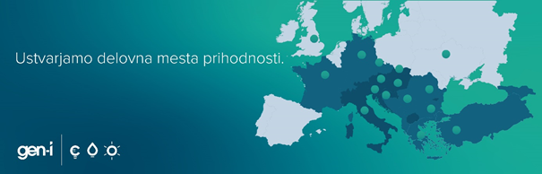

#### Razvijalec – študent (m/ž)

\

**Končuješ študij in bi rad/-a pridobil/-a izkušnje iz prakse? Si vedno sanjal/-a o tem, da bi oblikoval/-a, razvil/-a, preizkusil/-a in uvedel/-la programsko opremo za podporo trgovanju? Ti je berljivost kode pomembna? Stremiš k avtomatizaciji nalog? Če te zanima delo na projektih na področju trgovanja z energenti, vabljen/-a v našo ekipo razvijalcev in razvijalk programske opreme. Iščemo sodelavca/-ko z željo po delu na velikih sistemih in motivacijo za sledenje trendom na področju razvoja.**

**Energetika je na pragu velikih sprememb: razpršeni obnovljivi energetski viri, elektromobilnost, nove tehnologije, digitalizacija, trajnostne rešitve, čista in decentralizirana energija za vsakogar. Z odločnimi in samozavestnimi koraki v skupini GEN-I stopamo na pot zelene transformacije in spodbujamo posameznika, da pripomore k boljši, bolj zeleni prihodnosti. Z ekipo strokovnjakov raznovrstnih področij razvijamo rešitve, ki bodo omogočile čisto energijo in razogljičenje posameznika in podjetij. Že vse od svoje ustanovitve se uvrščamo med najbolj inovativne in hitro rastoče akterje, ne le na slovenskem ampak tudi na evropskem energetskem trgu. Z enakim zagonom in še večjo motivacijo želimo spremeniti svet na bolje.**

**Ker velike spremembe zahtevajo najboljše, iščemo okrepitve z najboljšimi.**

**Tvoji izzivi:**

- razvoj programske opreme,
- iskanje novih programskih rešitev,
- vzdrževanje obstoječih programskih rešitev,
- podpora internim uporabnikom,
- sodelovanje na IT projektnih nalogah.

**Naša pričakovanja:**

- imaš izkušnje z razvojem programske opreme (C#, Java, Python, …),
- poznaš orodja za verzioniranje kode (TFS, GIT),
- znane so ti relacijske podatkovne baze,
- si komunikativen/-na in ti ustreza delo v timih,
- aktivno znanje angleškega jezika,
- si začetnik ali izkušen programer (z veseljem te bomo povabili k sodelovanju in našli vsebine dela ter projekte, zanimive zate, saj je prostih več delovnih mest).

**Nudimo ti:**

- soustvarjanje zelene energetske transformacije s prodornim, mladim in zavzetim kolektivom,
- strokovni in osebni razvoj, podprt z izobraževanji in mentorskimi programi,
- delo v inovativnem energetskem podjetju in dinamičnem mednarodnem okolju,
- možnost testiranja novih zelenih tehnologij,
- neomejene količine kave in sadja na delovnem mestu in
- članstvo v aktivnem športnem društvu s 13 različnimi sekcijami, ki ponuja druženje z več kot 270 aktivnimi člani.

**Lokacija dela: Ljubljana ali Nova Gorica ali Krško**

**Rok prijave do vključno: 15. 2. 2021**

**Za prijavo pošlji svojo predstavitev z življenjepisom in motivacijskim pismom v slovenskem in angleškem jeziku prek** [**spletnega obrazca**](https://gen-i.si/o-gen-i/zaposlovanje/razpisi/obrazec-za-prijavo?geckoJobId=a0K1i00002DhYDlEAN&geckoBusinessUnit=0011i00000LgjopAAB)**.**
