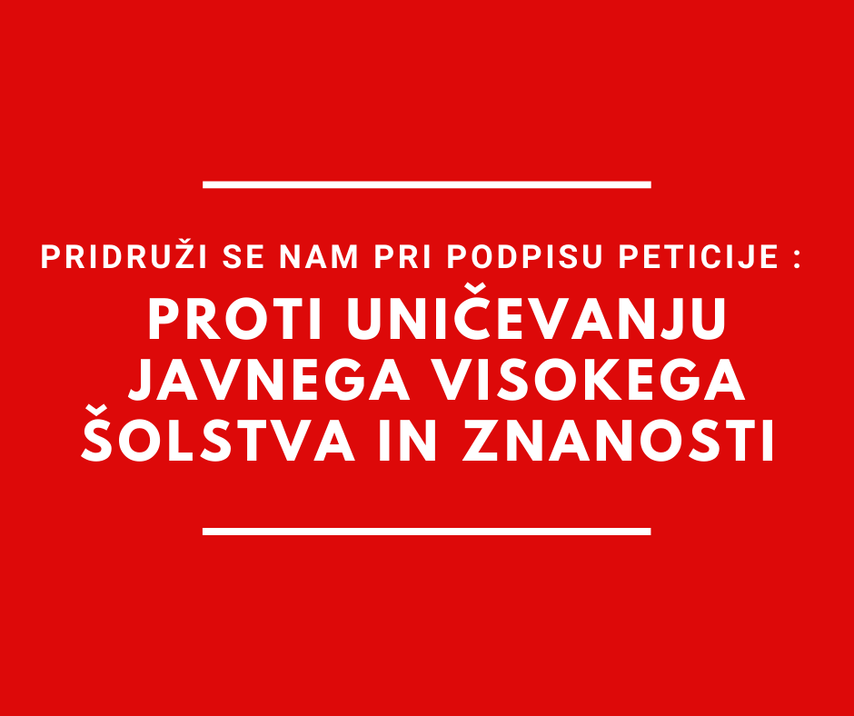

Podpisane članice in podpisani  člani akademske skupnosti s to [peticijo](https://www.akademska-skupnost.si/) ostro protestiramo proti posegom Vlade RS v visoko šolstvo in znanost. Gre za nerazumne poteze, s katerimi trenutna izvršna oblast spodjeda sisteme, ki so eden od zgodovinskih temeljev Republike Slovenije. Brez skupnosti zavezanih avtonomnih institucij, ki so intelektualni razvoj v naših krajih omogočale celo že pred ustanovitvijo univerz in inštitutov, sedanje države ne bi bilo. Tudi Državnega zbora kot nosilca suverenosti ne.

Vladna koalicija je z določbami Zakona o izvrševanju proračuna onemogočila zaposlovanje na raziskovalnih projektih in zaposlovanje mladih raziskovalcev celo v primerih, ko so bili projekti že pridobljeni in sredstva za zaposlitve že zagotovljena.

Poleg tega je vlada nepričakovano in v neskladju z dosedanjo prakso odložila potrditev razpisa za vpis v visokošolske zavode, čeprav je bil tako kot vsa leta poprej usklajen s pristojnim ministrstvom. To se je zgodilo tik pred že davno napovedanimi informativnimi dnevi. Resorna ministrica se tej nerazumljivi odločitvi, ki bi jo morala razumeti kot izraz nezaupanja, doslej ni zoperstavila.

Dejstvo, da bi bil iz morebitnih administrativnih omejitev vpisa izvzet samoplačniški študij, ne potrebuje komentarja.

Čeprav smo številni podpisniki in podpisnice pogosto kritizirali sedanji sistem visokega šolstva in znanosti in teh kritik ne bomo opustili, menimo, da se je treba tovrstnim destruktivnim dejanjem, ki ogrožajo same temelje našega razvoja in ta hip – čisto konkretno – usodo cele generacije prihodnjih študentk in študentov, z vsem civilnim pogumom upreti. Podpisane in podpisani nimamo enakih političnih prepričanj in se tudi v pogledih na prihodnost visokega šolstva in znanosti razlikujemo. Enotni pa smo v mnenju, da strankarska politika in zasebni interesi ne smejo ogroziti tistih temeljev, od katerih je odvisna prihodnost prebivalcev Republike Slovenije.

Dijaška organizacija Slovenije,

Inštitut za novejšo zgodovino,

Kemijski inštitut,

Konfederacija sindikatov Slovenije Pergam,

Koordinacija samostojnih raziskovalnih inštitutov Slovenije,

Univerza v Ljubljani,

Univerza v Mariboru,

Univerza na Primorskem,

Sindikat vzgoje, izobraževanja znanosti in kulture Slovenije,

Študentska organizacija Slovenije,

Visokošolski sindikat Slovenije,

Znanstveno-raziskovalno središče Koper.

**Podpiši peticijo proti uničevanju javnega visokega šolstva in znanosti!  **

<https://www.akademska-skupnost.si/>

**Na spletni strani najdete tudi predloge amandmajev k predlogu Zakona o dodatnih ukrepih za omilitev posledic covid-19 (PKP8). **
