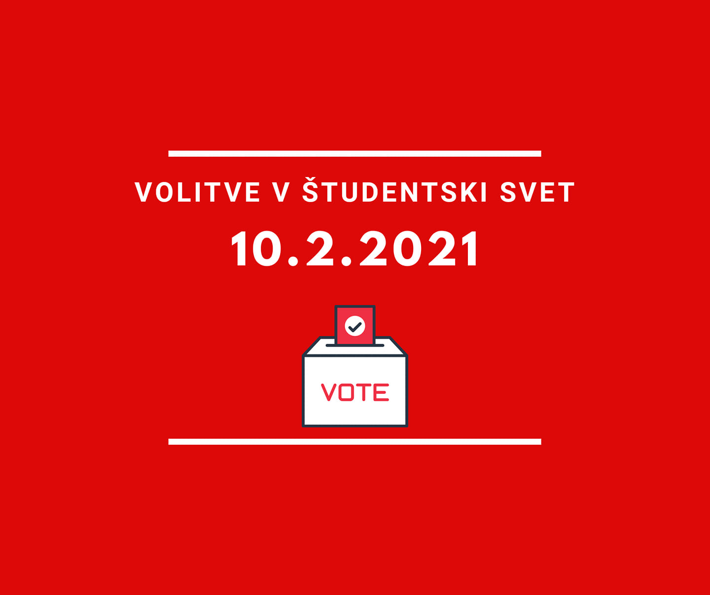

V sredo, 10. 2. 2021, bodo od 9.00 do 16.00 potekale volitve v Študentski svet Fakultete za računalništvo in informatiko. Izvedene bodo preko spletnega sistema Simply Voting. Navodila za glasovanje so dostopna na naslednji povezavi: [https://prijava.uni-lj.si/usi/\_layouts/15/WopiFrame.aspx…](https://prijava.uni-lj.si/usi/_layouts/15/WopiFrame.aspx?sourcedoc=%7B9ABA5C33-8D77-43E1-84FF-7B04D1E56E9B%7D&file=NavodilaZaGlasovanje-SimplyVoting1.docx&action=default&fbclid=IwAR3AnlbBpfkG-KujBYRUO-eWbvRkrPlvvmRetBBWwEXpo8L-ghsbN5zyaiM)

Seznam kandidatov si lahko ogledate na povezavi : [https://svet.fri.uni-lj.si/lista-kandidatov-za-ss-fri/](https://svet.fri.uni-lj.si/lista-kandidatov-za-ss-fri/?fbclid=IwAR04K2EoRKafNFouNWkSyJD6bGzu0DQyc10Etu7NBwXTHRiR1tB8Cnflpa0)
