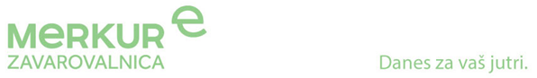

Le še 2 dni je do roka prijav, zato pohiti!!

**Merkur zavarovalnica** je del mednarodne zavarovalniške skupine Merkur, ene najstarejših zavarovalnic v Evropi. Delovanje Merkur zavarovalniške skupine ter s tem tudi Merkur zavarovalnice je že od samega začetka usmerjeno v zagotavljanje varnosti človeku. Svojim zavarovancem in zaposlenim zato že danes pomagamo živeti tako, da bomo jutri izžarevali zdrav življenjski stil in veselje do življenja. Z sloganom »Danes za vaš jutri« sporočamo poslovno filozofijo, ki poudarja optimizem, vitalnost ter zdrav način življenja.

*V našo ekipo vabimo študenta (m/ž) za delo na področju  ***informatike**

Iščemo osebo:

- ki obiskuje zaključni letnik Fakultete za računalništvo in informatiko,
- ki jo zanima podrobnejše spoznavanje s podatkovnimi skladišči in skrbništvo nad komunikacijami, omrežjem, sistemom, mrežnimi ter uporabniškimi aplikacijami,
- ki jo interesira skrbništvo in uvajanje sprememb v zavarovalniških aplikacijah,
- ki jo veseli pomoč uporabnikom,
- ki se v bodočnosti vidi morebiti v vlogi opravljanja nalog security inženirja,
- ki je samoiniciativna, natančna in odgovorna;
- in ki ima znanje angleškega jezika.

Nudimo:

- pridobivanje znanj in izkušenj s področja informatike v večjem podjetju;
- spoznavanje z delovanjem finančne inštitucije;
- možnost (kasnejše) redne zaposlitve;
- uvajanje in sodelovanje z izkušenim mentorjem;
- pridobivanje izkušenj v mednarodnem okolju, kjer je v ospredju strokovna rast posameznika.

Prijave:

- do 19.02.2021
- na <zaposlitev@merkur-zav.si>

Vabimo vas, da postanete del ponosne tradicije, ki traja že od leta 1798.

