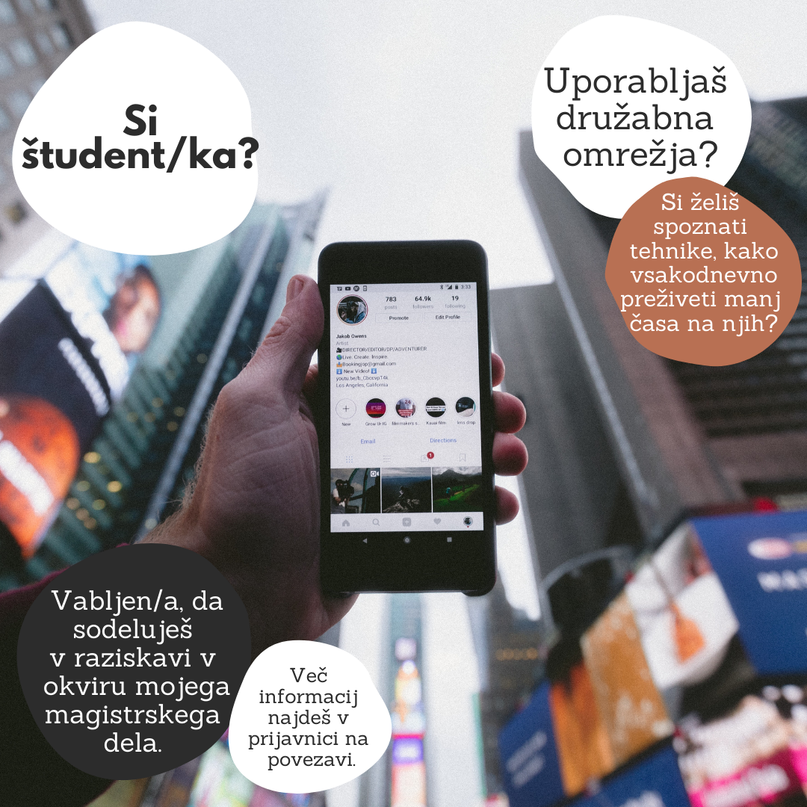

Družabna omrežjaso postala pomemben del našega vsakdana.\

**Si vedel/a, da**: jih (po podatkih iz januarja 2021) aktivno uporablja **4.20 milijard** svetovnega prebivalstva? To je več kot polovica; uporabniki družabnih omrežij stari od 16 do 64 let v povprečju preživijo na njih vsakodnevno **2 uri in 25 minut**? To je skoraj 17 ur v enem tednu in približno 884 ur v enem letu! Si tudi pri sebi že kdaj opazil/a, da si jim namenil/a več časa , kot bi si želel/a ali si sprva nameraval/a? Če te zanima še več statističnih podatkov in si želiš spoznati **tehnike, s katerimi lahko na družabnih omrežjih preživiš manj časa**, te vabim, da sodeluješ v raziskavi v okviru mojega magistrskega dela. V njej si dobrodošel/a tudi, če jih uporabljaš v manjši meri! ➡️ Povezava do prijavnice in več informacij o sami raziskavi: [https://docs.google.com/forms/d/e/1FAIpQLSeClf_LQMGSkyU6HSs7cJ_KspqOepL-ZqTo3YDJG4tydXOqCg/viewform](https://docs.google.com/forms/d/e/1FAIpQLSeClf_LQMGSkyU6HSs7cJ_KspqOepL-ZqTo3YDJG4tydXOqCg/viewform)\
