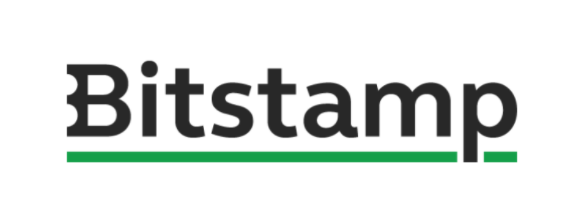

**Bitstamp, najstarejša svetovna borza kriptovalut, širi razvijalsko ekipo in išče talentirane inženirje, ki  imajo željo ustvarjati znotraj hitro rastoče FinTech industrije.  **

To je enkratna priložnost, da se pridružite hitro rastočemu mednarodnemu podjetju z vodilnim položajem  v enem najbolj obetavnih finančnih sektorjev. Že zdaj smo največja kripto borza v Evropi in povečujemo  svojo prisotnost po vsem svetu. Imeli boste priložnost delati v dinamični ekipi, ki postavlja standarde v  panogi, v odličnih delovnih pogojih v Ljubljani z možnostjo pridobivanja ekskluzivnega znanja in izkušenj.  Nudimo tudi možnosti osebnega in profesionalnega razvoja, teambuildinge, konkurenčno plačilo in ostale  ugodnosti ter sproščeno okolje, ki ceni sveže ideje.

**Te privlači: **

– ustvarjanje in nadgrajevanje naprednih produktov za trgovanje s kripto valutami z več miljardami  dnevenga prometa,

– načrtovanje in razvoj rešitev za več milijonov uporabnikov s celega sveta,

– zagotavljanje odzivnosti in varnosti platforme 24/7,

– iskanje elegantnih rešitev za kompleksne probleme,

– sodelovanje pri odkrivanju novih praks v finančnem svetu?

**Odprta delovna mesta (podroben opis na voljo na spodnji povezavi): **

**– Software engineer (junior, mid, senior) **

**– Frontend software engineer **

**– Quality engineer (web, mobile) **

**– Senior security engineer **

**– Cloud security engineer **

**– System operations engineer **

**– DevOps engineer **

**Nudimo možnost redne zaposlitve za nedoločen čas ali študentsko delo.  **

Če se tudi sam ukvarjaš s kripto valutami in te zanima valutno trgovanje, če imaš izkušnje iz FinTecha ali  pa si zgolj radoveden in si želiš postati del Bitstamp zgodbe, pošlji svojo prijavo prek spodnje povezave:

<https://bitstamp.talentlyft.com/#jobs>
