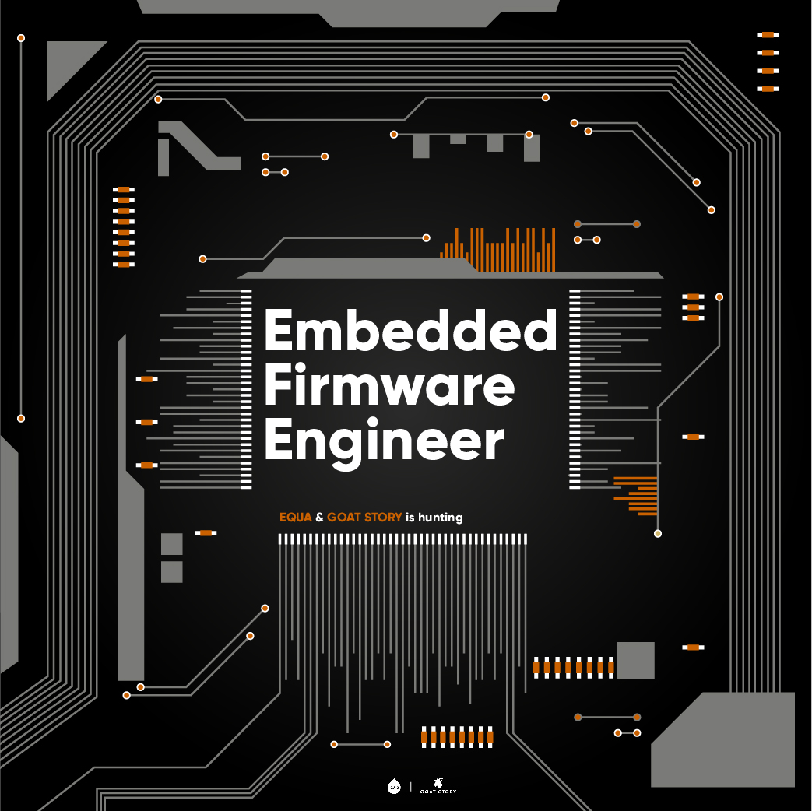

Blagovni znamki EQUA in GOAT STORY (Equa d.o.o. s sedežem v Ljubljani) se s svojim inovativnim programom produktov, na področju vrhunske kave in stekleničk za večkratno uporabo, uvršča v sam svetovni vrh. Globalno tržišče in globalna prepoznavnost nam omogočata resničen “thinking outside the box” in s tem nadvse zanimive razvojne podvige. \

**Obseg nalog:**

- Programiranje mikrokrmilnikov (ARM based SoCs kot je STM32, poznavanje Nordic SoCs je plus);
- Znanje  jezika C/C++;
- Razvoj tehničnih rešitev na podlagi idejnih zasnov;
- Izkušnje pri delu s senzorji, koračnimi motorji, enkoderji, itd.;
- Poznavanje Python-a in Linux-a je dobrodošlo;
- Testiranje naprav;
- Priprava za proizvodnjo.

**Od vas pričakujemo: **

- Razmišljanje izven okvirjev;
- Sposobnost dela v timu različnih strok;
- Osnovno znanje fizike;
- Pripravljenost na učenje in pridobivanje novih znanj;
- Iznajdljivost, drznost in ustvarjalnost;
- Zmožnost dela v v visoko intenzivnem, hitro spreminjajočem se poslovnem okolju;
- 2 leti delovnih izkušenj na področju razvoja (ni pa pogoj).

**Kaj vam ponujamo: **

- Zaposlitev za nedoločen čas s poskusno dobo;
- Konkurenčno plačilo za dobro opravljeno delo in možnost napredovanja;
- Inovativno in dinamično delovno okolje;
- Nenehno podporo in razvoj, s katerima te spodbujamo, da postaneš najboljša verzija samega sebe;
- Kreativno okolje, kjer lahko izražaš in implementiraš svoje ideje – ne bojimo se napak, ampak stagnacije;
- Mlado in ambiciozno vodstvo, ki svojo ekipo razvija po načelu ‘’learning by doing’’, zato smo pripravljeni upoštevati tvoja mnenja in predloge in se tudi od tebe naučiti kaj novega;
- Vedno ogromno količino odlične kave!

Prijavo z motivacijskim pismom in življenjepisom (opcijsko) pošljite na [nace@goat-story.com](mailto:nace@goat-story.com) in [anze@goat-story.com](mailto:anze@goat-story.com)
