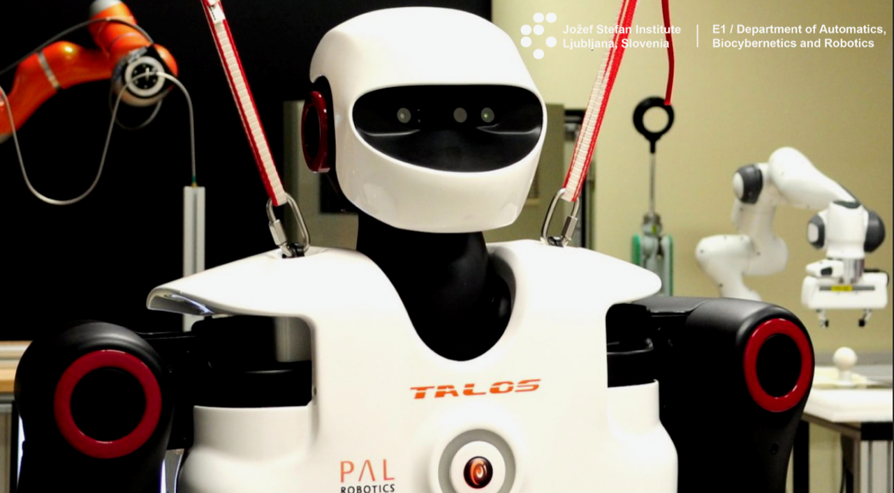

**PROSTI DELOVNI MESTI V OKVIRU PROGRAMA MLADI RAZISKOVALCI**

**PROSTI DELOVNI MESTI V OKVIRU PROGRAMA MLADI RAZISKOVALCI NA ODSEKU ZA AVTOMATIKO, BIOKIBERNETIKO IN ROBOTIKO (ABR) NA INSTITUTU “JOŽEF STEFAN” (IJS) V LJUBLJANI, Z ZAČETKOM S ŠTUDIJSKIM LETOM 2021/22.**

Iščemo doktorske študente s področij elektrotehnike, računalništva, mehatronike, matematike ali fizike, ki bi se pridružili naši raziskovalni skupini kot mladi raziskovalci.

Področja raziskav zajemajo:\
(a) robotsko globoko učenje in manipulacijo,\
(b) obtelesne robotske mehanizme (eksoskelete),\
(c) sodelovanje robotov s človekom,\
(d) kognitivno humanoidno robotiko.

Več informacij o temah je na spletnih straneh odseka ABR na [https://abr.ijs.si](https://abr.ijs.si/) ter na spletnih straneh dveh laboratorijev v okviru ABR, na [http://nbr.ijs.si/](http://nbr.ijs.si/) in [http://www-hcr.ijs.si/](http://www-hcr.ijs.si/).

Delovna mesta bodo na Institutu “Jožef Stefan” v okviru programa ARRS Mladi raziskovalci s plačano šolnino za doktorski študij, ki se bo izvajal ali na Univerzi v Ljubljani ali na Mednarodni podiplomski šoli Jožefa Štefana.

Kandidat/ka mora izpolnjevati pogoje kot jih za program Mladi raziskovalci zahteva ARRS. Povprečje ocen na prvi in drugi stopnji študija mora imeti vsaj 8,0 ter ne sme biti starejši/-a od 28 let.

Za več informacij in prijavo pošljite email s pripetim kratkim življenjepisom ter motivacijskim pismom na [e1-tajnistvo@ijs.si](mailto:e1-tajnistvo@ijs.si) do 15. 06. 2021. V emailu tudi jasno izrazite želeno področje raziskav.

**SEVERAL FOUR-YEAR, FULL-TIME PHD POSITIONS**

**SEVERAL FOUR-YEAR, FULL-TIME PHD POSITIONS AT THE DEPARTMENT FOR AUTOMATICS, BIOCYBERNETICS AND ROBOTICS AT JOŽEF STEFAN INSTITUTE, LJUBLJANA, SLOVENIA, STARTING ON OCTOBER 1ST 2021.**

We are looking for several PhD students with background in electrical engineering, computer science, mechatronics, mathematics or physics to strengthen our research team in the fields of either:\
(a) robot deep learning and manipulation,\
(b) wearable robotics,\
(c) physical human-robot collaboration or\
(d) cognitive humanoid robotics.

For more information on the topics see the webpages of the department [https://abr.ijs.si](https://abr.ijs.si/) and of two of its laboratories at [http://nbr.ijs.si/](http://nbr.ijs.si/) and [http://www-hcr.ijs.si/](http://www-hcr.ijs.si/).

The successful candidates will be offered four-year full-time contracts funded by the Slovenian Research Agency within the Young researchers programme. The positions are at Jožef Stefan Institute and the PhD studies will take place at either the University of Ljubljana or the Jožef Stefan International Postgraduate School. The cost of the PhD studies tuition will be fully covered.

Candidates must have an average grade for all examinations and coursework at bachelor’s and master’s degree at least 8.00 (out of 10). The age of the candidate should not exceed 28 years, as specified by the Slovenian Research Agency.

To apply, please submit your CV, a short motivation letter, and your preference to one of the above four fields to **[e1-tajnistvo@ijs.si](mailto:e1-tajnistvo@ijs.si)**, before June 15^(th).
