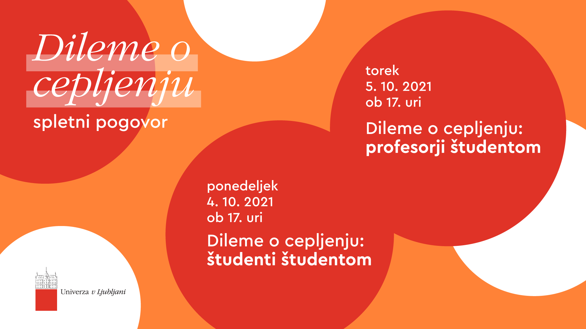

**Ker na Univerzi v Ljubljani zaupamo v znanost in odprti dialog, bomo v ponedeljek in torek, 4. in 5. oktobra 2021, oba dneva ob 17. uri, organizirali spletna pogovora z naslovom Dileme o cepljenju. Oba pogovora bomo prenašali na** [**YouTube kanalu Univerze v Ljubljani**](https://www.youtube.com/user/univerza1)**, udeležba bo mogoča tudi prek aplikacije ZOOM, kjer bo mogoče zastavljati tudi vprašanja (več informacij o udeležbi prek zoom-a bo znanih kmalu). Od torka do četrtka, od 5. do 7. oktobra, Univerza v Ljubljani v sodelovanju z Zdravstvenim domom Ljubljana organizira tudi cepljenje za študentke, študente in zaposlene. Več informacij najdete** [**tukaj.**](https://www.uni-lj.si/v_ospredju/2021090315310609/)

Dileme o cepljenju: študenti študentom

Na prvem pogovoru – Dileme o cepljenju: študenti študentom – bodo sodelovale študentke in študenti, in sicer:

- predstavnik **projekta** [**Imuno**](https://projektimuno.si/index.html) (Javnozdravstveni projekt, ki deluje v okviru Društva študentov medicine Slovenije in združuje študente različnih naravoslovnih fakultet Univerze v Ljubljani. Namen projekta je izobraziti javnost o pomenu cepljenja, ji predstaviti njegovo varnost in učinkovitost ter doseči ustrezno precepljenost populacije.),
- svetnica ŠS UL, članica ŠS Fakultete za farmacijo UL in študentka laboratorijske biomedicine **Marjeta Lipužič**,
- nekdanji senator in svetnik ŠS UL ter študent farmacije **Jaka Vrevc Žlajpah**.

Pogovor bo moderiral novoizvoljeni senator ŠS UL **Anžej Tomaž Hvala**.

Vabljeni **v ponedeljek, 4. oktobra 2021, ob 17. uri**. Pogovor bomo prenašali na [YouTube kanalu Univerze v Ljubljani](https://www.youtube.com/user/univerza1), udeležba bo mogoča tudi prek aplikacije ZOOM, kjer bo mogoče zastavljati tudi vprašanja (več informacij o udeležbi prek zoom-a bo znanih kmalu).\

Dileme o cepljenju: profesorji študentom

Na drugem pogovoru – Dileme o cepljenju: profesorji študentom – bodo sodelovali novoizvoljeni rektor UL prof. dr. Gregor Majdič, bodoča prorektorica prof. dr. Ksenija Vidmar Horvat ter profesorice in profesorji UL, predstavnice in predstavniki medicinske in pravne stroke:

- **prof. dr. Gregor Majdič**, rektor Univerze v Ljubljani in profesor za fiziologijo na Veterinarski fakulteti Univerze v Ljubljani,
- **prof. dr. Ksenija Vidmar Horvat**, prorektorica Univerze v Ljubljani in profesorica sociologije na Filozofski fakulteti Univerze v Ljubljani,
- **prof. dr. Tatjana Avšič Županc,** profesorica za mikrobiologijo in imunologijo na Medicinski fakulteti Univerze v Ljubljani in članica Slovenske akademije znanosti in umetnosti,
- **prof. dr. Alojz Ihan,** profesor za mikrobiologijo in imunologijo na Medicinski fakulteti Univerze v Ljubljani,
- **prof. dr. Saša Zagorc**, profesor za ustavno pravo na Pravni fakulteti Univerze v Ljubljani.

Vabljeni **v torek, 5. oktobra 2021, ob 17. uri**. Pogovor bomo prenašali na [YouTube kanalu Univerze v Ljubljani](https://www.youtube.com/user/univerza1), udeležba bo mogoča tudi prek aplikacije ZOOM, kjer bo mogoče zastavljati tudi vprašanja (več informacij o udeležbi prek zoom-a bo znanih kmalu).\

Cepljenje za študentke, študente in zaposlene

Univerza v Ljubljani v sodelovanju z Zdravstvenim domom Ljubljana organizira cepljenje za študentke, študente in zaposlene. Cepljenje bo potekalo od torka do srede, od 5. do 7. oktobra 2021. Več informacij najdete [tukaj.](https://www.uni-lj.si/v_ospredju/2021090315310609/)

