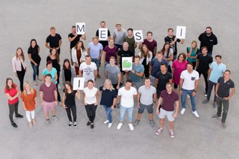
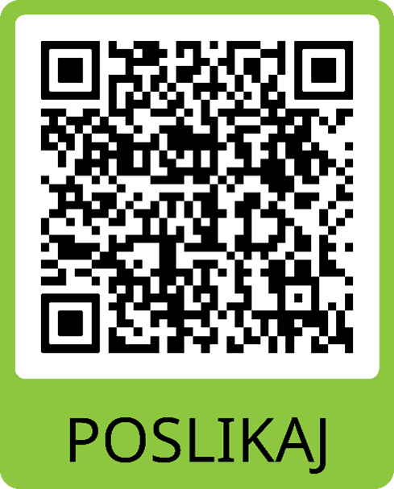
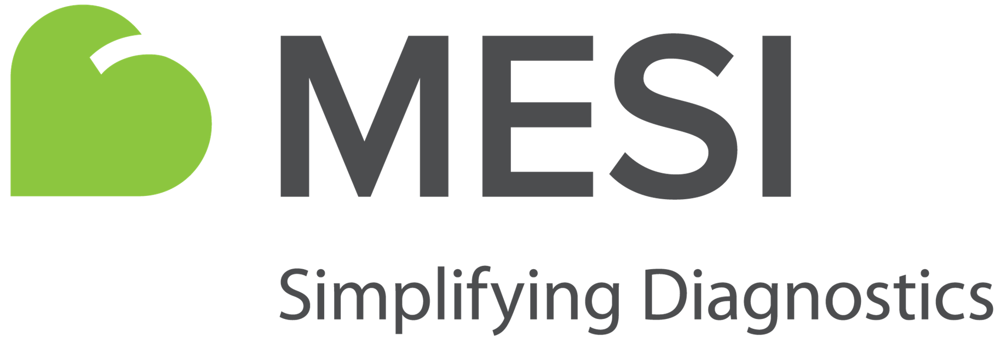

**Java/Kotlin razvijalec/-ka**

Ti je pomembno, da si del področja, ki prispeva k skupnemu dobremu? Bi te motiviralo delo v podjetju, ki pomaga pri zgodnjem odkrivanju bolezni in tako rešuje življenja? Se vidiš v preoblikovanju konvencionalnega medicinskega okolja z uvedbo naprednih tehnologij? Potem smo pravi zate!

Podjetje **MESI d.o.o.** je specializirano za razvoj naprav, ki pomagajo zaposlenim v medicini in zdravstvu. Naše inovacije se uporabljajo v 50 državah in zanje smo prejeli številne nagrade in certifikate. Naš najpomembnejši produkt je MESI mTABLET, ki se brezžično povezuje z različnimi diagnostičnimi moduli. Na enem mestu zbira vse opravljene meritve ter z vpogledom v zgodovino pacienta zdravnikom omogoča hitro in učinkovito diagnostiko.

Iščemo **Java/Kotlin razvijalca/-ko**, ki bi se pridružil/-a naši ekipi, odgovorni za operacijski sistem in komercialne aplikacije na našem MESI mTABLET-u. Za sistem imamo velike načrte, saj mu bomo dodali kup novih funkcij in razvili API-je za zunanje razvijalce, s tem pa se bo vrednost našega produkta še povečala. V tem, kar počnemo, smo edinstveni in veselimo se, da bomo s tabo postali še boljši.

**Delovne naloge:**

- pomoč pri oblikovanju in razvoju novih aplikacij na Android platformi;
- sodelovanje z več funkcijskimi ekipami pri definiranju, oblikovanju in »deployanju« novih funkcij;
- testiranje robustnosti kode, vključno z mejnimi primeri, uporabnostjo in splošno zanesljivostjo;
- prepoznavanje in reševanje primerov ozkih grl (bottle necks), odprava napak (bugs) in izboljšava zmogljivosti aplikacij;
- stalno odkrivanje, vrednotenje in implementacija novih tehnologij za večjo razvojno učinkovitost.

[TABLE]

**Ponujamo:**

- delo v dinamični mednarodni ekipi, ki ustvarja vrhunske rešitve v družini prijaznem in spodbudnem okolju;
- možnost nadaljnje zaposlitve za nedoločen čas;
- veliko ustvarjalnosti;
- neodvisnost in timsko delo s sodelavci, navdušenimi nad razvojem visokokakovostnih programskih rešitev;
- obilo priložnosti za učenje in napredovanje;
- konkurenčno plačilo **10 €/uro (neto)**;
- fleksibilen delovni čas.

**Ti je priložnost zanimiva? Poslikaj QR kodo in nam pošlji svoj življenjepis.**

MESI d.o.o.\
Leskoškova 11a\
1000 Ljubljana\
<jobs@mesimedical.com>
