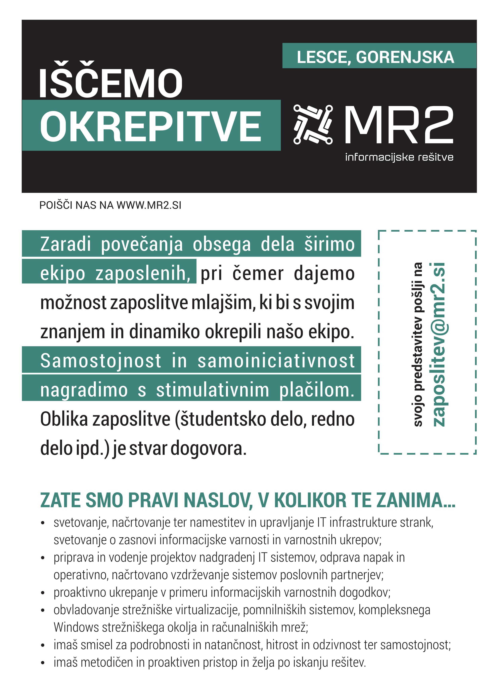

MR2 je slovensko podjetje na področju informacijskih rešitev. Ustanovljeno je bilo leta 1991 s sedežem v Lescah na Gorenjskem. Smo zanesljiv in pošten poslovni partner in delodajalec, ki zaposlenim zagotavlja sproščeno in urejeno delovno okolje. Zaradi povečanja obsega dela širimo ekipo zaposlenih, pri čemer dajemo možnost zaposlitve mlajšim, ki bi s svojim znanjem in dinamiko okrepili našo ekipo. Osnova dejavnost podjetja MR2 d.o.o. je računalniški inženiring, skrbimo tako za učinkovito upravljanje z IT opremo poslovnih subjektov in njihovo nemoteno in varno delovanje.

Urna postavka (študentsko delo): 10€ bruto oziroma po dogovoru

