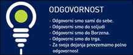
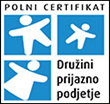
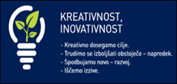

Borzen izvaja gospodarsko javno službo dejavnost operaterja trga z elektriko ter dejavnost Centra za podpore. S svojimi storitvami zagotavlja in omogoča usklajeno delovanje slovenskega elektroenergetskega sistema in izvaja podporno shemo za proizvodnjo zelene energije. Izvaja naloge vodenja bilančne sheme, evidentiranje bilateralnih pogodb, izdelavo okvirnega voznega reda ter bilančni obračun in finančno poravnavo poslov povezanih s predhodno navedenimi nalogami. Podpira okoljevarstveno politiko ter osvešča javnost. V okviru lastne blagovne znamke TRAJNOSTNA ENERGIJA izvaja dejavnosti informiranja, ozaveščanja in usposabljanja o obnovljivih virih energije in učinkoviti rabi energije ter na ta način podpiramo okoljevarstvene politike preko osveščanja javnosti.

Za boljši jutri želimo prispevati že danes, zato svoje moči usmerjamo k izpolnjevanju strateških ciljev, ki so tesno povezani z okoljevarstvenim področjem, s poudarkom na obnovljivih virih energije in učinkovite rabe energije.

 Več: [www.borzen.si](http://www.borzen.si) & www.trajnostnaenergija.si

**Iščemo študenta/dijaka (Ž/M) za pomoč v IT-ju**

Iščemo dijaka/dijakinjo srednje šole ali študenta/študentko tehnične smeri informatika oz. druge ustrezne smeri za občasno delo in pomoč v službi za informacijsko tehnologijo. Delo večinoma poteka v dopoldanskem času na lokaciji družbe Borzen v Ljubljani, v ocenjenem obsegu približno 100 ur na mesec.

Od kandidata/ke pričakujemo:

- osnovno poznavanje Windows in Windows Server operacijskih sistemov,
- osnovno poznavanje Aktivnega Imenika in domenskega omrežja,
- osnovno poznavanje Microsoft 365 produktov.

Delo bo obsegalo pomoč pri priklopu računalniške opreme, pripravi računalnikov, nameščanju programske opreme, razreševanju osnovnih težav pri prezentacijah v konferenčnih dvoranah, vzdrževanje strojne in programske opreme, sodelovanje pri zagotavljanju brezhibnega in nemotenega delovanja informacijske in komunikacijske infrastrukture in sistemov v podjetju.

Zainteresirani kandidati bodo po prijavi na oglas, naknadno prejeli kratek test oziroma vprašalnik, na podlagi katerih bomo izbrane kandidate povabili na razgovor.

**Višina urne postavke znaša 10,00 EUR bruto. Po zaključku študija je možna tudi redna zaposlitev.**

Prijave z življenjepisom sprejemamo na <kadri@borzen.si> do 15. maja 2022

- 

- 

- 

