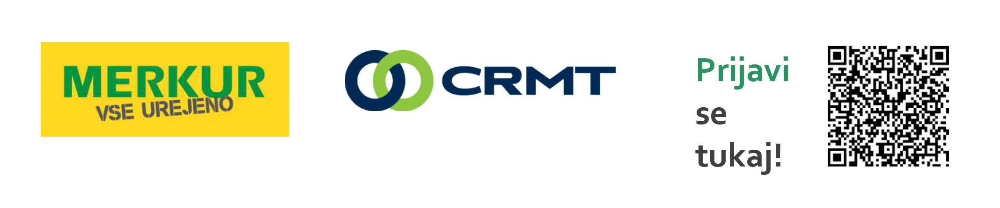

## **BI BOOTCAMP MERKUR – ONLINE**

#### Obožuješ izzive? Razmišljaš analitično?\
**Potem je čas, da se pridružiš BOOTCAMP IZZIVU z MOŽNOSTJO ZAPOSLITVE!**

Z junijem 2022 v podjetju MERKUR trgovina, d.o.o. pričenjamo **z** **BI BOOTCAMP MERKUR** – virtualnim usposabljanjem na področju upravljanja in priprave podatkov**.** Bootcamp bo potekal preko Zoom platforme v izvedbi podjetja CRMT in bo trajal približno dva tedna (termine izvedbe najdeš spodaj). Vsak dan bomo začeli s predavanjem, ki mu bo sledilo delo na konkretnem primeru, da naučeno takoj preizkusimo tudi v praksi.

**P.S. Ali veš, da v podjetju MERKUR novo znanje tudi nagradimo? Udeležba na Bootcamp izzivu je plačana 6,17 EUR bruto / uro. Povej naprej!**

**S čim vse se bomo spoznali?**\
osnove jezika SQL ▪ osnove modeliranja in izgradnje podatkovnih skladišč ▪ modeliranje transformacije podatkov (ETL) ▪ modeliranje BI (Business Intelligence) rešitve ▪ platforme MS SQL, [**MicroStrategy**](https://www.microstrategy.com/us)

**V okviru Bootcamp izziva bomo izdelali:**\
Analizo podatkovnih virov ▪ model podatkovnega skladišča ▪ model prenosa podatkov ▪ transformacijo podatkov s pomočjo SQL ▪ BI (Business Intelligence) model ▪ implementacijo BI modela v okolju [MicroStrategy](https://www.microstrategy.com/us) ▪ 2 nadzorni plošči v MicroStrategy okolju

**Kaj pričakujemo od tebe?**\
Osnovno poznavanje podatkovnih baz in SQL poizvedovanja ▪ sposobnost analitičnega razmišljanja in hitrega učenja ▪ komunikativnost, radovednost in analitično razmišljanje

**Kaj ti ponujamo?**\
**Plačano udeležbo na bootcampu** za 6-8 najboljših kandidatov, ki bodo oddali prijavo. Za res odlične udeležence **možnost zaposlitve** na izzivov in priložnosti polno delovno mesto analitika v super kolektivu. **Možnost napredovanja** in s tem aktivne vloge pri uvajanju napredne BI rešitve v podjetju.

**Termini usposabljanja:**\
1.6. 9:00 – 13:00 **SQL** / 2.6. 9:00-13:00 **SQL** / 6.6. 12:00 – 16:00 **SQL/DW** / 7.6. 11:00 – 15:00 **SQL/DW** / 15.6. 9:00 – 13:00 **MSTR** / 16.6. 9:00 – 13:00 **Projekt**

**Kaj potrebuješ?**\
Dobro predstavitev, na podlagi katere so bomo lahko odločili zate. V času izobraževanja moraš s seboj imeti pozitiven pristop in svoj prenosni računalnik.

#### Prijave zbiramo do vključno 30. maja 2022 (predviden začetek 1. junija) na [www.merkur.si/bootcamp](http://www.merkur.si/bootcamp) ali poskeniraj QR kodo.

*Dodatne informacije na* [*zaposlitev@merkur.si* ](mailto:zaposlitev@merkur.si) *(v naslovu naj bo beseda Bootcamp).*
