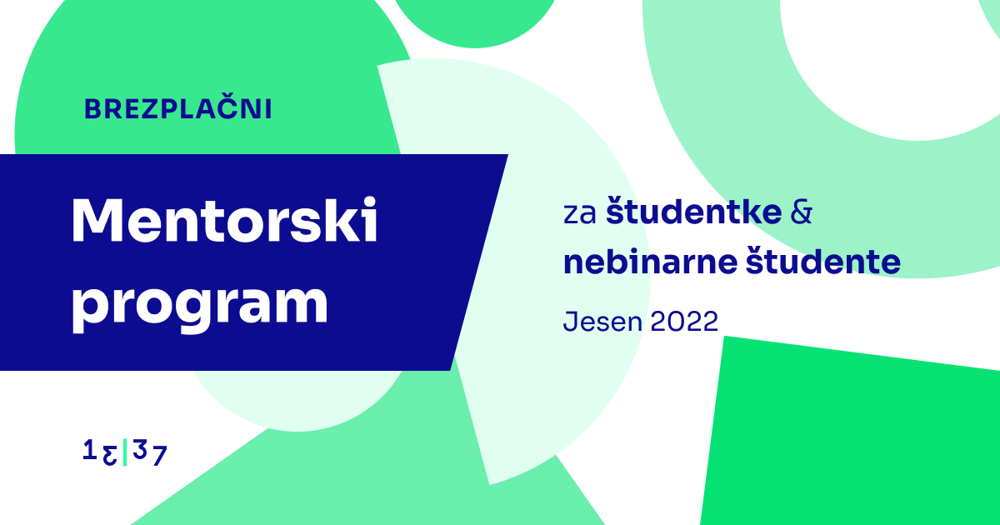

**13\|37 Voyage predstavlja mentorski program za študentke in nebinarne študente**, ki je predvsem namenjen podpori in profesionalnemu razvoju študentov. Program združuje študente z izkušenimi in empatičnimi mentorji iz podjetja 13\|37 ter jih opolnomoči s pravimi orodji in znanjem za uspeh v tehnološki industriji.

Kot del tega programa boste dobili mentorje, ki vas bodo vodili na vaši profesionalni poti ter vam bodo pomagali, da bo ta pot lažja in usmerjena. Poleg tega boste vključeni v različne delavnice, konference in druge dogodke, ki jih organiziramo za naše zaposlene za utrditev tehničnega znanja ter razvoj mehkih veščin.

Program je popolnoma brezplačen in traja eno leto. Po zaključku programa niste vezani na zaposlitev v 13\|37. Kljub temu upamo, da se bomo **dobro ujeli in bomo v prihodnosti še sodelovali skupaj**.

Program je predvsem namenjen študentom ki se ukvarjajo z računalništvom, programiranjem, dizajnom ali z drugimi podobnimi področji.

Več informacij o programu najdete na spletni strani: **[1337.voyage](http://1337.voyage/)**.

Prijava preko: [**1337co.de/mentorship**](https://1337co.de/mentorship). Prijave so odprte do 30.07.2022.

Pri 13\|37 resnično verjamemo v pomen raznolike in vključujoče delovne sile. Pravzaprav je “**embrace difference**” ena od naših petih temeljnih vrednot poleg “enjoy the ride”, “challenge now”, “go beyond” in “be genuine”. S tem programom **želimo zgraditi poti in ustvariti priložnosti za marginalizirane skupine v tehnološkem sektorju**. To so skupine, ki zaradi manjše zastopanosti in uveljavljenih pristranskosti v tehnološki industriji žal nimajo vedno prijetnih izkušenj z delom ali dostopa do enakih možnosti.
