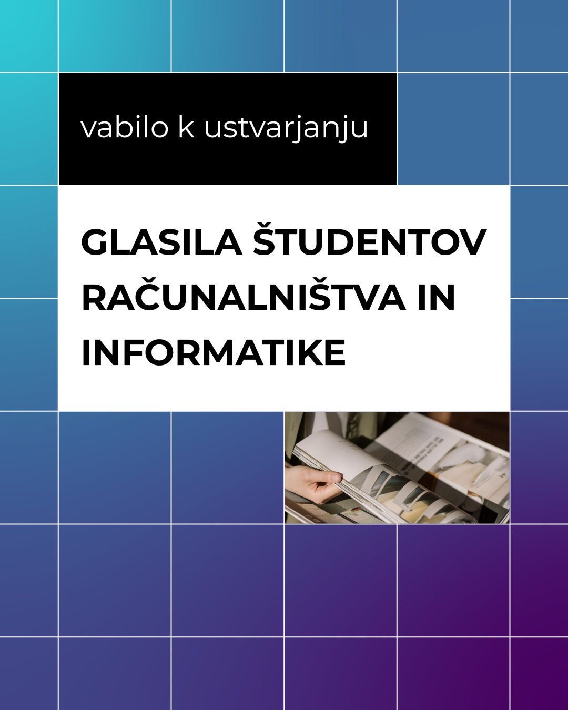

Uredniški odbor **glasila študentov računalništva in informatike Frik++** vas vabi k objavi različnih strokovnih in tudi nestrokovnih prispevkov v novonastalem glasilu.

Namen glasila študentov računalništva in informatike je študentom ponuditi možnost predstavitve svojega (strokovnega) dela kolegom in širši javnosti, v njem pa se bodo združili strokovni članki kot tudi ostali prispevki. Izbrani strokovni prispevki bodo vneseni tudi v sistem Cobiss in tako na voljo za uveljavljanje pri postopkih pridobivanja štipendije.

Podrobnosti lahko najdete na [www.glasilo-fri.si](http://www.glasilo-fri.si/)

\
