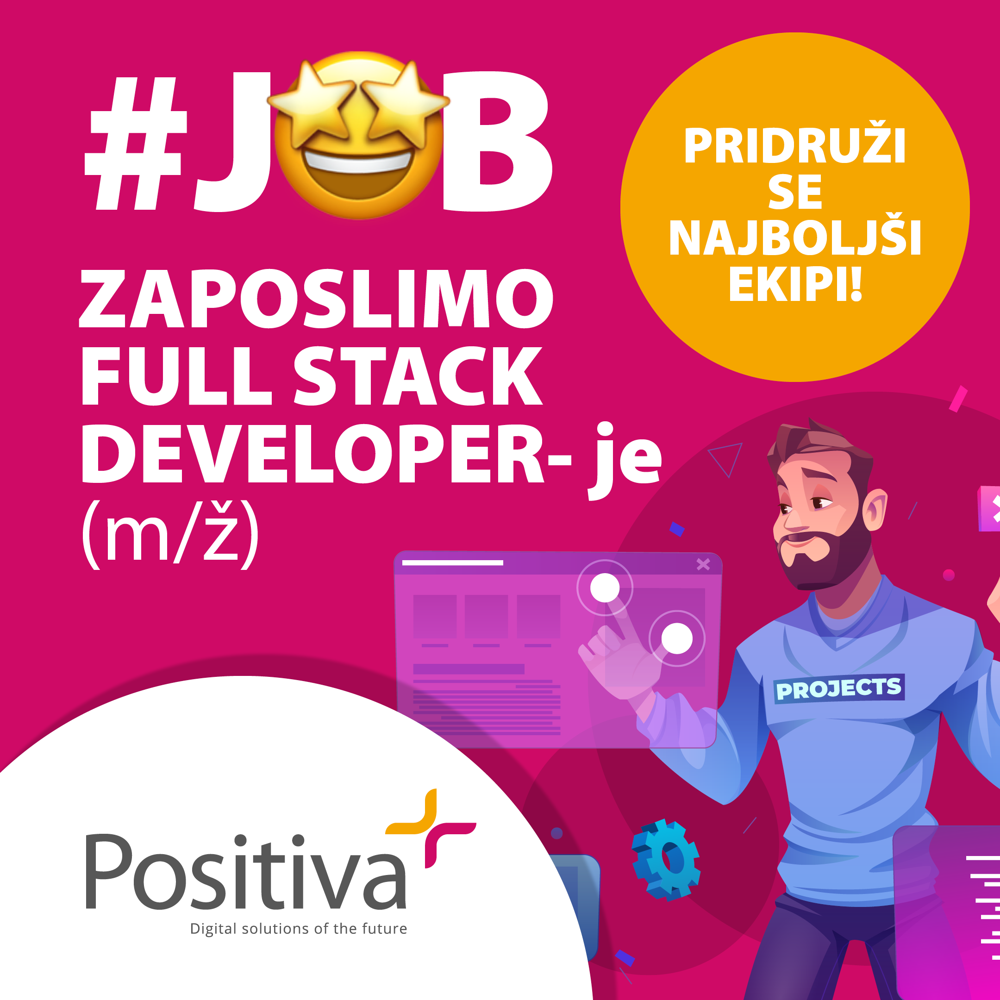

Podjetje Positiva d.o.o. zaposli **FULL STACK DEVELOPER**– je (m/ž)\

**Pričakujejo:**

- Nekaj izkušenj z PHP/MySQL
- Željo po učenju in izobraževanju
- Željo po delu na E-commerce projektih (Magento, WooCommerce …)
- Poznavanje enega PHP framework-a na MVC arhitekturi (Laravel, Symfony, Zend Framework)
- Poznavanje enega Javascript framework-a (Jquery, Angular, JSON,Vue.js)
- Poznavanje HTML5, CSS3
- Poznavanje načinov integracij (SOAP, REST, API, Web Services,…)
- Poznavanje GIT
- Team spirit

**Ponujajo:**

- Strokovne izzive in delo z velikimi, tudi mednarodnimi naročniki
- Izobraževanje na strokovnih delavnicah in mednarodnih konferencah
- Prijetno delovno okolje na hitro dostopni lokaciji, nedaleč od avtoceste
- Mesečno plačilo glede na raven znanja
- Stimulativno plačilo min. 8 EUR/uro neto
- Prilagodljiv delovni čas in možnost dela na daljavo
- Možnost redne zaposlitve

Vabijo vas, da vašo prijavo z življenjepisom ter opisom delovnih izkušenj pošljete na naslov: *zaposlitev@positiva.si*

Podjetje Positiva je hitro rastoče visoko tehnološko podjetje, ki povezuje kreativnost s programskimi orodji. Bogate izkušnje s področja klasičnega tržnega komuniciranja združujemo z razvojem digitalnih orodij v optimalen splet komunikacijskih rešitev za naše naročnike. Positiva se ukvarja z izdelavo spletnih strani, portalov in trgovin, mobilnih, spletnih in\
poslovnih aplikacij ter snovanjem in izvedbo komunikacijskih strategij in oglaševalskih kampanj.\
Več o nas: <https://www.positiva.si/positiva/>

