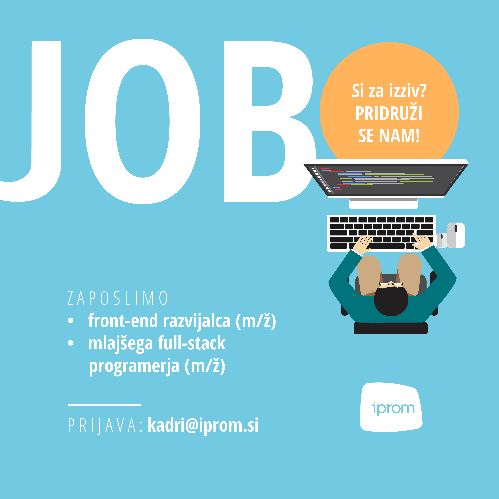

V družbi iPROM zaposlijo mlajšega full-stack programerja in mlajšega front-end razvijalca (m/ž).

Družba iPROM, vodilni regijski ponudnik medijskih in tehnoloških rešitev za digitalnooglaševanje, zaradi povečanega obsega dela in širitve na tuje trge išče dva (2) novasodelavca v razvojni ekipi.

V svoje vrste vabi mlajšega front-end razvijalca (m/ž) in mlajšega full-stack programerja (m/ž), ki bosta imela priložnost sodelovati pri razvoju neodvisnihtehnoloških rešitev za digitalno oglaševanje ter nenehno inovirati na področjumarketinških tehnologij.

Novima sodelavcema obljubljajo dinamično, inovativno in prijetno delovno okolje,možnost kariernega razvoja in sodelovanje z vrhunskimi strokovnjaki na področju razvoja digitalne oglaševalske tehnologije ter plačilo 2000-3000 bruto EUR/mesec.

Vse zainteresirane kandidate vabijo k oddaji življenjepisa in kratkega spremnega pisma do 31. oktobra 2023 prek elektronske pošte kadri@iprom.si ali prek spletnega obrazca na spletni strani.

[iPROM_OGLAS ZA ZAPOSLITEV_Mlajši full-stack programer](iPROM_OGLAS-ZA-ZAPOSLITEV_Mlaj%C5%A1i-full-stack-programer.docx)

[iPROM_OGLAS ZA ZAPOSLITEV_Mlajši front-end razvijalec](iPROM_OGLAS-ZA-ZAPOSLITEV_Mlaj%C5%A1i-front-end-razvijalec.docx)
