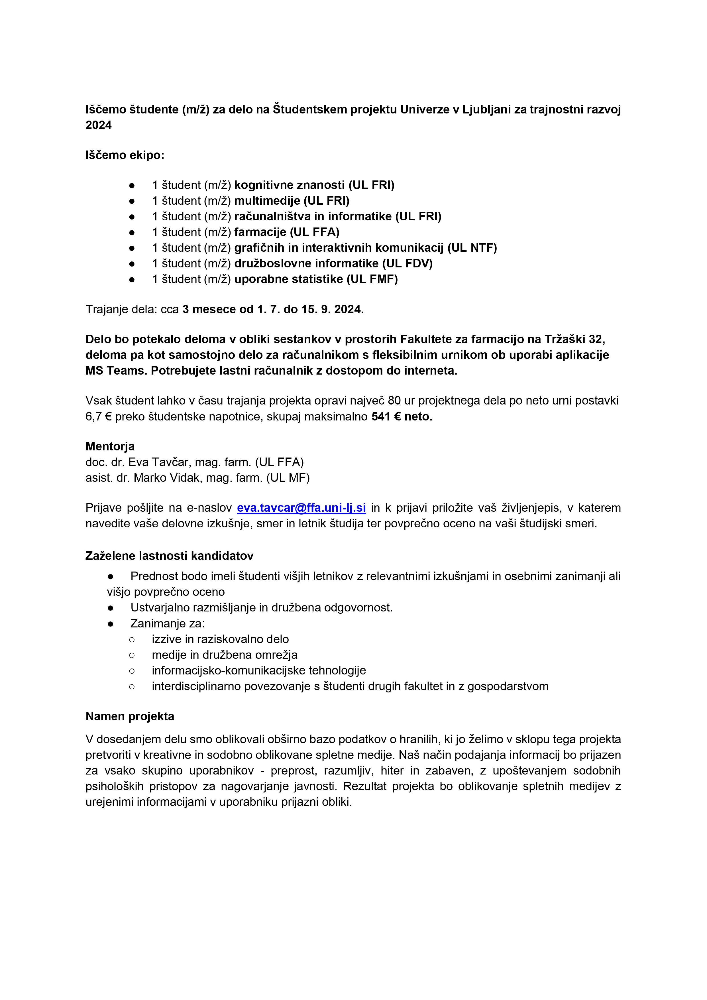

Iščemo študente (m/ž) za delo na Študentskem projektu Univerze v Ljubljani za trajnostni razvoj 2024

Iščemo ekipo:\
– 1 študent (m/ž) kognitivne znanosti (UL FRI)\
– 1 študent (m/ž) multimedije (UL FRI)\
– 1 študent (m/ž) računalništva in informatike (UL FRI)\
– 1 študent (m/ž) farmacije (UL FFA)\
– 1 študent (m/ž) grafičnih in interaktivnih komunikacij (UL NTF)\
– 1 študent (m/ž) družboslovne informatike (UL FDV)\
– 1 študent (m/ž) uporabne statistike (UL FMF)

Trajanje dela: cca 3 mesece od 1. 7. do 15. 9. 2024.\
Vsak študent lahko v času trajanja projekta opravi največ 80 ur projektnega dela po neto urni postavki 6,7 € preko študentske napotnice, skupaj maksimalno 541 € neto.

Namen projekta:\
V dosedanjem delu smo oblikovali obširno bazo podatkov o hranilih, ki jo želimo v sklopu tega projekta pretvoriti v kreativne in sodobno oblikovane spletne medije. Naš način podajanja informacij bo prijazen za vsako skupino uporabnikov – preprost, razumljiv, hiter in zabaven, z upoštevanjem sodobnih psiholoških pristopov za nagovarjanje javnosti. Rezultat projekta bo oblikovanje spletnih medijev z urejenimi informacijami v uporabniku prijazni obliki.\

Prijave pošljite na e-naslov eva.tavcar@ffa.uni-lj.si

[Študentski projekt UL za trajnostni razvoj 2024](%C5%A0tudentski-projekt-UL-za-trajnostni-razvoj-2024.docx)
