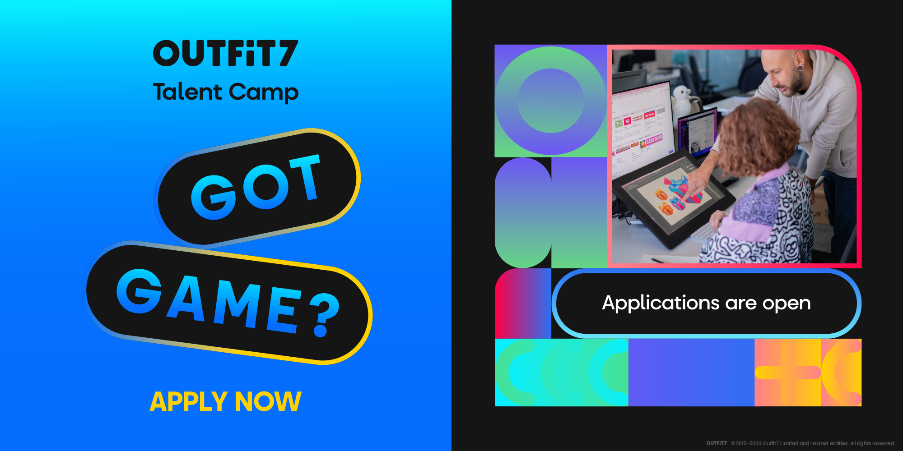

Outfit7 Talent Camp je štiridnevna delavnica, ki jo organizira Outfit7 Group v Ljubljani. Izbrani talenti bodo od 25. do 27. septembra v Ljubljani, ustvarjali mobilne igre s pomočjo izkušenih mentorjev, ki razvijajo svetovne hite, kot je My Talking Tom. Prijave potekajo do konca junija.

Outfit7 Talent Camp 2024 bo 30 talentom omogočil, da skupaj z mentorji v treh dneh ustvarijo unikatne mobilne igre. Na zaključnem dogodku bodo svoje izdelke predstavili in se podružili s strokovnjaki na področju razvoja iger. ki jih bodo zadnji dan tudi predstavili na zaključnem dogodku.

Vsi, ki vas zanima ustvarjanje mobilnih iger, se lahko prijavite na povezavi <https://outfit7.com/talent-camp>

