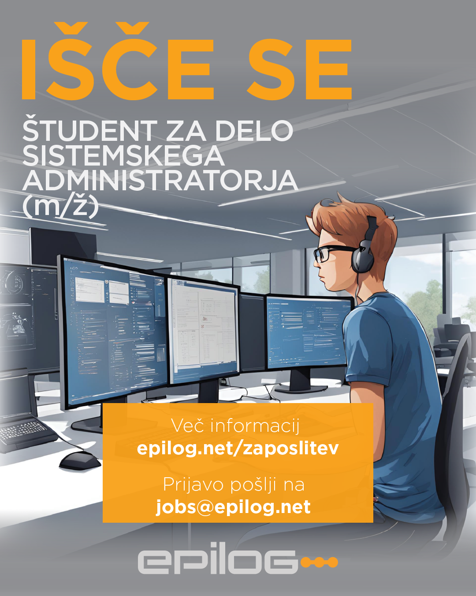

Si tehnično podkovan študent, ki ga navdušuje informacijska tehnologija in iščeš resnične izzive ter izkušnje, ki bi dopolnjevale tvoj študij?

Vstopi v Epilog. Med druščino hi-tech navdušencev, ki razvija in implementira najzahtevnejše programske rešitve za podporo procesom logistike. Ali bolj enostavno: povezujejo ljudi, stroje in stvari v enoten sistem.

Njihove pisarne se nahajajo v Tehnološkem parku Ljubljana, ki je le streljaj od FRI-ja. Ponujajo ti stalen stik z nasodobnejšimi tehnolgijami, možnost izobraževanja na različnih področjih, sproščeno delovno okolje ter možnost štipendiranja in kasnejše zaposlitve.

Za pomoč pri vzdrževanju njihovega IT okolja iščejo navdušenega, natančnega in predanega sistemskega administratorja – študenta.

Delovne naloge obsegajo:\
– namestitev, konfiguracijo in vzdrževanje Windows delovnih postaj,\
– administracijo standardne programske opreme,\
– vzdrževanje strojne opreme,- tehnično podporo uporabnikom,\
– sodelovanje pri urejanju IT administrativnih postopkov in dokumentacije.

Za opravljanje nalog moraš dobro poznati operacijski sistem Windows in MS Office okolje. Če si pripravljen na sodelovanje, se učiti in se vživeti v svet sistemske administracije, te bodo pri tem podprli in ti ponudili mentorstvo. Vedo, da nisi senior, če si v resnici še študent.

Začetna študentska urna postavka je 9,00 € bruto.

Sreča je na strani pogumnih! Zato ne odlašaj in se jim čim prej oglasi s CV-jem na jobs@epilog.net.Prijave sprejemajo do zapolnitve mesta. Še več o razpisanem prostem delovnem mestu in Epilogu izveš z obiskom spletne strani https://www.epilog.net/zaposlitev

